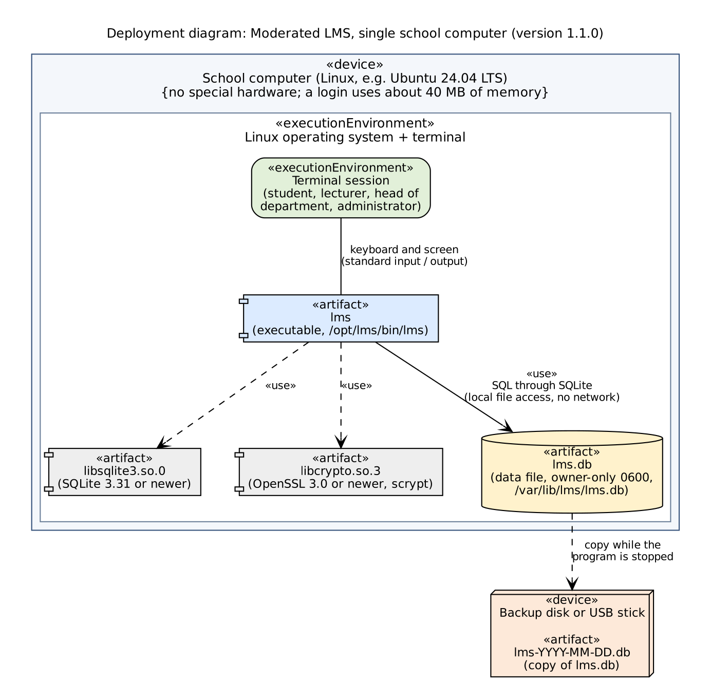

# Installation Guide (for the school technician)

Version 1.1.0 (installs 1.0.0 too: use the tag you need). You do not need to know C++. You need a Linux computer, an internet connection for the first install,
and about 20 minutes. Every command below was run on a clean Ubuntu 24.04 computer before this guide was written.

## 1. What gets installed

The system is **one program** (`lms`) and **one data file** (`lms.db`) on **one computer**. There is no server, no
network connection and no database password to set up. Staff and students use it by typing in a terminal window on that
computer. Source of the diagram: `diagrams/deployment.dot` (also `deployment.svg`).

| Item | Where it goes | Who may read it |
|---|---|---|
| Program `lms` | `/opt/lms/bin/lms` | everyone |
| Data file `lms.db` | `/var/lib/lms/lms.db` | the `lms` account only |
| Backups | a USB stick or another disk | the technician |

Because the data file is private to one account, **everyone uses the program through the same Linux account called
`lms`**, each person logging in to the program with their own username and password.

## 2. What you need

| Requirement | Detail |
|---|---|
| Computer | Linux with a terminal. Tested on Ubuntu 24.04 LTS. Ubuntu 22.04 meets the minimum tool versions (CMake 3.16, SQLite 3.31, OpenSSL 3.0) but was not tried |
| Packages | `build-essential`, `cmake`, `libsqlite3-dev`, `libssl-dev` (needed only to build) |
| Accounts | Permission to use `sudo` |
| Disk | Space for the build tools; the program is under 1 MB and the data file is small (the empty file is 128 KB) |
| Source code | The project folder (from GitHub `https://github.com/katleho419/lms-cs4433` or the zip file) |

## 3. Install, step by step

Open a terminal. Type each command, press Enter, and check the result before the next one.

**Step 1: install the tools**

    sudo apt update
    sudo apt install -y build-essential cmake libsqlite3-dev libssl-dev git

**Step 2: get the source code**

    git clone https://github.com/katleho419/lms-cs4433.git
    cd lms-cs4433
    git checkout v1.1.0

If you have a zip file instead: `unzip lms.zip` and `cd lms`.

**Step 3: build the program**

    cmake -S . -B build -DCMAKE_BUILD_TYPE=Release -DCMAKE_INSTALL_PREFIX=/opt/lms
    cmake --build build

Expected: the last line says `Built target lms`. Do **not** add `-DLMS_ENABLE_TEST_CLOCK=ON`; that option is for testing
only and lets anyone change the clock.

**Step 4: install the program**

    sudo cmake --install build

Expected: a line `Installing: /opt/lms/bin/lms`.

**Step 5: create the account and the data folder**

    sudo useradd --system --create-home --home-dir /home/lms --shell /bin/bash lms
    sudo mkdir -p /var/lib/lms
    sudo chown lms:lms /var/lib/lms
    sudo chmod 700 /var/lib/lms

**Step 6: create the first administrator**

    sudo -u lms /opt/lms/bin/lms --db /var/lib/lms/lms.db

The program says `No accounts exist yet. Create the first administrator.` Type a username, a full name and a password
(8 to 128 characters, at least one letter and one digit, not the same as the username). The password is not shown while
you type. The program prints `Administrator created.` and shows the login prompt
(`Log in (leave the username empty to quit)`). Press Enter on the empty username to quit; you will log in properly in
section 4.

Never use `--seed-demo` on the school computer. It creates accounts whose passwords are published in the README.

## 4. Check that the installation works

| # | Check | Command | Expected |
|---|---|---|---|
| 1 | Program is installed | `ls -l /opt/lms/bin/lms` | the file is listed |
| 2 | Data file is private | `sudo ls -l /var/lib/lms/lms.db` | starts with `-rw-------` and owner `lms` |
| 3 | Release build (no test clock) | `strings /opt/lms/bin/lms \| grep -c LMS_FAKE_NOW` | `0` |
| 4 | Program starts and the administrator can log in | `sudo -u lms /opt/lms/bin/lms --db /var/lib/lms/lms.db` | `Welcome, <name> (Administrator).` |
| 5 | Wrong password is refused | log in with a wrong password | `! Invalid username or password.` |

If all five pass, write the date and your name on the handover sheet (section 9).

## 5. Starting the system each day

    sudo -u lms /opt/lms/bin/lms --db /var/lib/lms/lms.db

To save typing, add this line to `~/.bashrc` of the account that staff use:

    alias lms='sudo -u lms /opt/lms/bin/lms --db /var/lib/lms/lms.db'

Then people only type `lms`. One person uses the program at a time per terminal window; several terminal windows
can be open together (the data file waits up to 5 seconds when another window is saving).

## 6. Backup and restore

**Back up** (at least once a week, and before every upgrade). Make sure nobody is logged in, then:

    sudo cp /var/lib/lms/lms.db /media/USB/lms-$(date +%F).db
    sudo chmod 600 /media/USB/lms-$(date +%F).db

Keep the backup somewhere other than the computer. It contains every mark and every password hash, so treat it like the
original: keep it locked away.

**Restore** (for example after a disk failure):

    sudo cp /media/USB/lms-2026-11-03.db /var/lib/lms/lms.db
    sudo chown lms:lms /var/lib/lms/lms.db
    sudo chmod 600 /var/lib/lms/lms.db

Then start the program and log in to confirm that the data is there. Marks entered after the backup date are lost; ask
lecturers to re-enter them.

## 7. Upgrading to a new version

1. Back up (section 6).
2. `cd lms-cs4433 && git fetch --tags && git checkout <new tag>`
3. Repeat steps 3 and 4 of section 3 (build and install). The data file is not touched.
4. Run the five checks in section 4.

Going from 1.0.0 to 1.1.0 needs no data change: the data file format is the same, so the existing `lms.db` is used as it is.
If a new version needs a different data layout, the program refuses to open the old file (message
`created by a different version of this program`) instead of damaging it. Restore the old program version from its tag and ask the developer.

## 8. Uninstalling

    sudo rm -r /opt/lms
    sudo cp /var/lib/lms/lms.db /media/USB/lms-final.db    # keep a last backup first
    sudo rm -r /var/lib/lms
    sudo userdel lms

## 9. Troubleshooting

| What you see | Cause and fix |
|---|---|
| `Could NOT find SQLite3` or `Could NOT find OpenSSL` during build | Tools missing: repeat step 1 |
| `cmake: command not found` | Repeat step 1 |
| `Fatal: Cannot open the database file` | The folder `/var/lib/lms` does not exist or the `lms` account cannot write to it: repeat step 5 |
| `Fatal: ... created by a different version of this program` | The file is from an incompatible version: restore the backup or use a new `--db` file |
| `Fatal: database is locked` | Another window has the file open for more than 5 seconds: close it and retry |
| `--seed-demo needs an empty database.` | Only for new, empty files; do not use it on the school computer |
| `Too many failed attempts. Exiting.` | Five wrong passwords: start the program again. (There is no password reset: the administrator creates a new account for a user who has forgotten the password) |
| Times are one or two hours out | The program shows Lesotho time (SAST, UTC+2) whatever the computer's own clock zone; check the date and time of the computer |

## 10. Security checklist for the technician

- [ ] Program built without the test clock (check 3).
- [ ] Data file is mode 600 and owned by `lms` (check 2).
- [ ] `--seed-demo` was never used; no published passwords exist.
- [ ] The administrator password is not written on a sticker near the computer.
- [ ] Backups are kept in a locked place.
- [ ] The computer's own clock is correct (deadlines depend on it).

## 11. Handover sheet

| | |
|---|---|
| Computer name | |
| Version installed | v1.1.0 |
| Installed by | |
| Date | |
| Checks 1 to 5 passed | yes / no |
| Backup location | |
