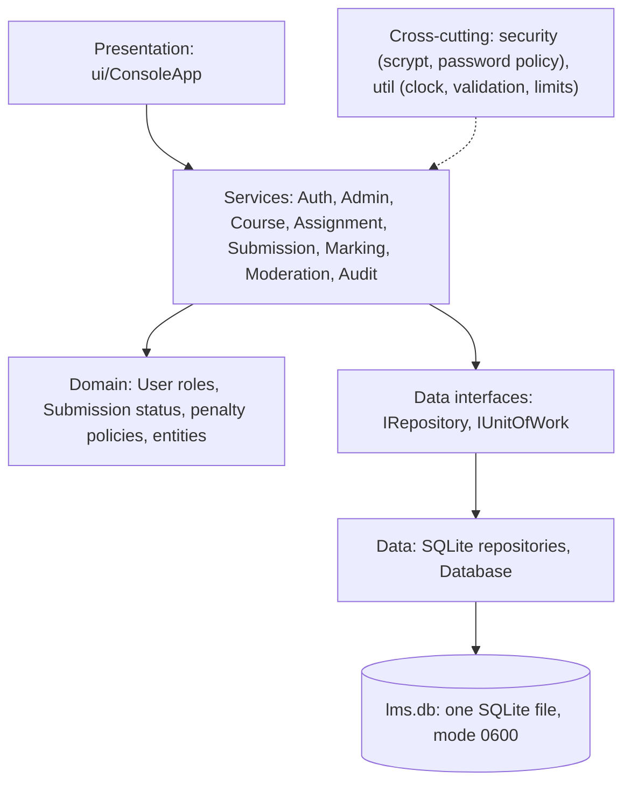
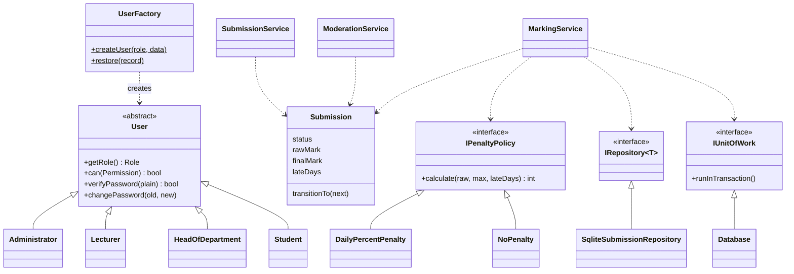
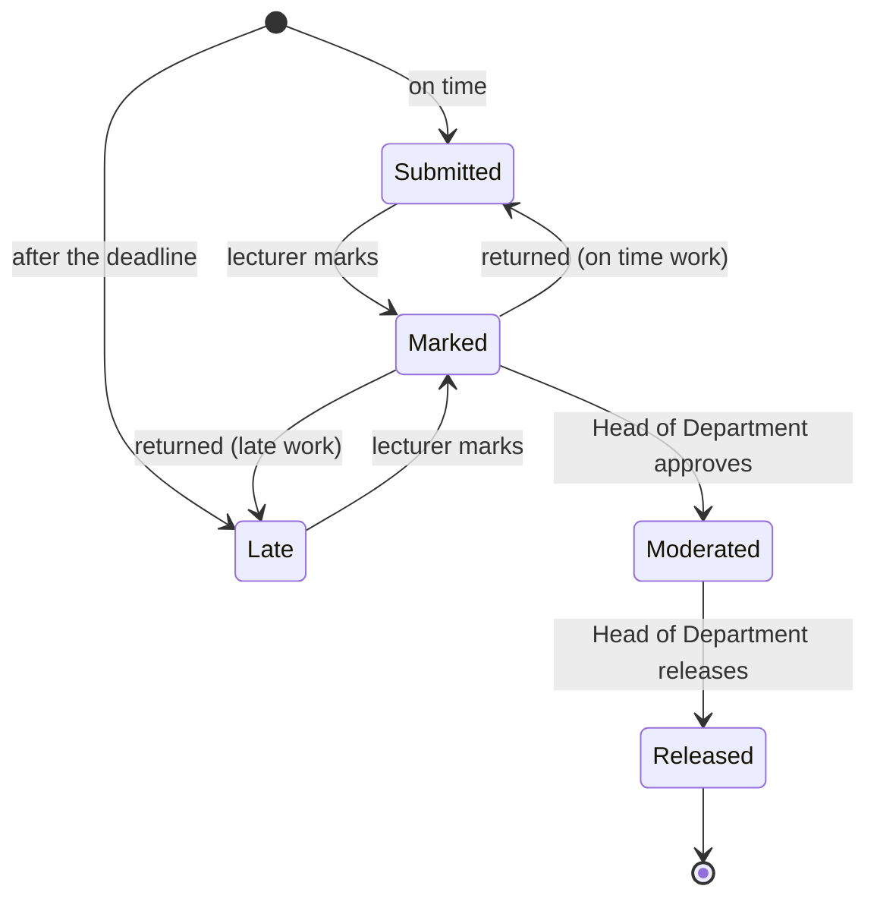
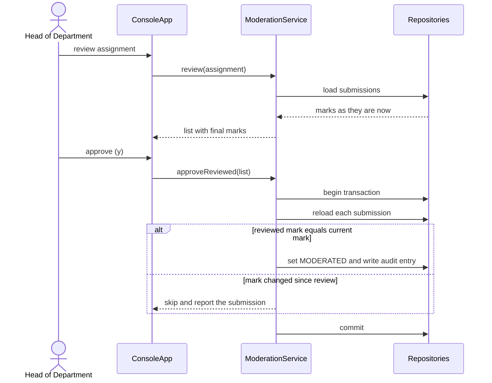
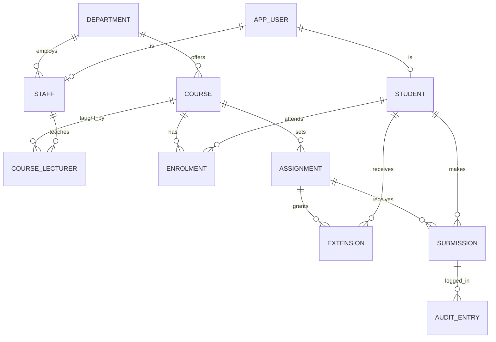

# Moderated Learning Management System: Project Report

| | |
|---|---|
| Course | CS4433 Software Engineering, National University of Lesotho |
| Author | Mafeta Katleho |
| Student number | 202322709 |
| Version reported | 1.1.0 (tag `v1.1.0`); report release `v1.1.2` |
| Repository | <https://github.com/katleho419/lms-cs4433> |
| Date | 2026-11-04 |

The submitted PDF is `LMS_Final_Report.pdf`. This file is the same report in Markdown.

## 1. Abstract

In many departments a lecturer's mark can reach a student before anyone else has looked at it. Late penalties are worked out by hand, so two students who handed in equally late can be treated differently, and when a mark is changed there is often nothing to show who changed it or why. This report describes the Moderated Learning Management System, a C++17 console program with a SQLite database, which I built to deal with these problems. Students submit work and lecturers mark it. A Head of Department then has to approve every mark before it is released. The program applies the late penalty with one fixed rule, and every change to a mark goes into a log that cannot be edited.

I worked in eight phases using a waterfall process arranged as a V-model, and then made one maintenance release. The report covers the project plan, the requirements and use cases, the design, the implementation, testing, configuration management and quality assurance, deployment, the change request, and the professional, legal and ethical issues. Version 1.1.0 passes 221 automated tests and covers 98.6% of the business-logic lines. Neither of the two static analysers reports anything. I found four software defects and fixed all of them. The limits of the system are listed in the conclusion.

Keywords: software engineering, V-model, moderation of marks, late penalty, audit log, C++17, SQLite, testing.

## 2. Introduction

### 2.1 Context and problem

A mark can change what happens to a student next, and a wrong one is hard to take back. The case study for this course describes an institution where marking depends on the habits of the person doing it. I picked out four problems. Nothing requires a second person to check a lecturer's mark before the student sees it. The late rules are applied by hand, so the penalty for the same lateness differs from marker to marker. When a mark changes, there is often no record of who changed it, when, or for what reason. And a student can sometimes see a mark that is still under review and might still change.

All four come from the same place: the rules of moderation live in people's habits and not in the system. If the system holds the rules they are the same for everyone, and if it keeps a record they can be checked.

### 2.2 Aim and objectives

My aim was to build and document a working system in which a Head of Department checks every mark before release, the program applies the late rule in one way for everyone, and every change to a mark is recorded permanently. To get there I set seven objectives:

1. Specify the requirements and use cases, and trace each one to a test.
2. Design a layered architecture that can be tested, using recognised design patterns [5], [6].
3. Implement it in C++17 with safe password storage and a reliable database.
4. Verify and validate the system at four levels and measure the results.
5. Manage the work with version control, continuous integration and recorded reviews.
6. Prepare the system for installation by a school technician, and show that it can be changed safely after release.
7. Identify the professional, legal and ethical issues of holding students' marks.

### 2.3 Scope

The system covers accounts and roles, departments and courses, enrolment, assignments with deadlines and extensions, versioned submissions, marking with an automatic late penalty, moderation, release and an audit log. It runs on one computer and has a console interface. I left out a web or network interface, file uploads, plagiarism checking, e-mail, time zones other than Lesotho time, a password-reset flow and encryption of the data file. I decided this at the start, and the conclusion comes back to these exclusions as limitations.

### 2.4 Method and structure of the report

I used the V-model, a version of the waterfall model in which every development phase on the left of the V has a test level on the right that checks its output [1], [2]. The waterfall model itself goes back to Royce [3]. It fitted this project because the requirements come from a fixed case study and the course asks for one document per phase. Section 3 is the project management plan, section 4 the requirements, section 5 the design and section 6 the implementation. Section 7 covers verification and validation, section 8 configuration management and quality assurance, section 9 deployment and section 10 maintenance. Section 11 deals with professional, legal and ethical issues, and section 12 concludes.

Each section summarises a document from the project. They are all in the `docs` folder of the Git repository [15].

## 3. Project management plan

### 3.1 Process model and why it was chosen

There is one developer on this project, the brief is fixed, there are few stakeholders, and a document is due at the end of each phase. In those conditions a plan-driven model makes sense, since late changes to the requirements only hurt when the requirements keep changing [1]. I preferred the V-model to the plain waterfall model because it makes me write the test plan against what each phase produces: unit tests against the detailed design, integration tests against the architecture and the database design, system tests against the requirements and use cases, and acceptance tests against what the stakeholders need. I did not choose an agile approach because there were no users to give feedback between iterations. The one change after release went through a formal change request (section 10).

### 3.2 Phases, deliverables and milestones

I divided the work into eight phases. Each ended with a deliverable, and from the fourth phase on it also ended with an annotated version tag in Git, so the state of the project at each milestone can be recovered exactly.

| Phase | Work | Main deliverables | Milestone | Date |
|---|---|---|---|---|
| 1 | Requirements | Stakeholder analysis, requirements specification, use case specifications | Requirements baseline | 2026-10-05 |
| 2 | Analysis | Use case model, domain model, business rules | Analysis baseline | 2026-10-12 |
| 3 | Design | Architecture, class diagrams, state machine, database design | Design baseline | 2026-10-17 |
| 4 | Implementation | C++17 source, schema, build files | `v0.4.0` | 2026-10-25 |
| 5 | Verification and validation | Test strategy, 205 tests, coverage report, defect log | `v0.5.0` | 2026-11-02 |
| 6 | Configuration management and quality assurance | Branching strategy, CI, static analysis, metrics, code review | `v0.6.0` | 2026-11-03 |
| 7 | Release and deployment | Installation guide, user manual, release notes | `v1.0.0` | 2026-11-03 |
| 8 | Maintenance | Change request CR1 with impact analysis | `v1.1.0` | 2026-11-03 |

After the eighth phase I added the document on professional, legal and ethical issues (2026-11-04), a deployment diagram, the project video and this report.

### 3.3 Work organisation and roles

I carried out the project alone and acted as analyst, designer, developer, tester, reviewer and release manager. I also used an AI assistant to help write and review code, tests and documents. I directed the work, ran every build and test myself, checked the results against the documents, and I am responsible for what is submitted. Section 11.4 says more about this. Working alone means that every review was a review of my own work, and I count that as a limitation. To reduce the effect I reviewed against a written checklist of 35 items, and every finding was fixed and retested with evidence.

### 3.4 Estimation and progress monitoring

I tracked progress by deliverables and automated evidence and not by hours. The measures were the number of passing tests, the line coverage of the business-logic layer, the number of static-analysis findings, the highest cyclomatic complexity of any function, and the number of open defects. I recorded each one in the report at the end of its phase, so a change from one version to the next is easy to see: the highest complexity fell from 35 to 14, and the number of tests went from 205 to 207 and then 221. Continuous integration repeated the build, the tests and both static analysers on every push and pull request. I counted a phase as finished only when its exit criteria were met. For testing these were that every test passed, that no Critical or High defect was open, and that coverage of the business logic was at least 70%.

### 3.5 Risk management

I listed the risks at the start and looked at them again at the end of each phase. The register gives the likelihood and impact of each risk, what I did about it, and its status. The updated register is in Appendix D. Several of the risks actually happened. The concurrency defect I expected for moderation turned up as DEF-02. GoogleTest disappeared from my development machine and I could not download it again, which put the evidence for the maintenance release at risk. And I committed the first phases straight to the main branch, before I had a branching rule. Each of these did limited damage, and sections 7 and 8 describe what I did about them.

### 3.6 Quality, communication and configuration plan

Quality was managed with tests derived from the requirements, static analysis, metrics with fixed limits, and a code review against a checklist. Configuration management uses Git with GitHub Flow and semantic version tags (section 8). Communication with the assessor is through the documents in the repository and the release notes.

## 4. Requirements engineering

### 4.1 Stakeholder analysis

The stakeholders are the people who use the system, the people it affects, and the people who run it. Their interests differ, and some of them conflict, which is why roles and permissions are so central to the design.

| Stakeholder | Interest | Influence | Main need |
|---|---|---|---|
| Student | High: marks affect their future | Low | Fair marks, privacy, seeing only released marks |
| Lecturer | High | Medium | Mark their own courses quickly, with the penalty applied for them |
| Head of Department | High | High | Check, adjust, return and release marks, with a record |
| Administrator | Medium | Medium | Set up terms, courses and accounts without seeing passwords |
| The school (data controller) | High | High | Compliance with data protection law, a system it can explain |
| Developer | High | High | A system that is correct, testable and maintainable |

I took the requirements from the case study supplied with the course, which describes the institution, its roles and how marking is done. I did not have access to real users, and this limits validation. The acceptance tests stand in for the stakeholders: each scenario is written from the need of one role and only passes if the person in it can reach the goal using the menus.

### 4.2 Software requirements specification

The specification follows the structure recommended in ISO/IEC/IEEE 29148 [4]: purpose and scope, functional requirements, non-functional requirements, constraints and assumptions. Each requirement has a priority, and I implemented everything marked Must. There are two main functional requirements, submitting work and moderated marking and release, and two main non-functional requirements, security and privacy, and accountability and integrity.

| ID | Requirement |
|---|---|
| FR1 | **Submit work.** A student submits an answer for an assignment in an enrolled course. Before the deadline the student can submit again. After the deadline the work is accepted once and marked LATE |
| FR2 | **Moderated marking and release.** A lecturer marks the work. A Head of Department approves it and may adjust or return it. Only approved work is released, and a student sees nothing before release |
| NFR1 | **Security and privacy.** Salted scrypt password hashes, a permission check and a relationship check on every action, parameterised SQL only, and a data file readable only by its owner |
| NFR2 | **Accountability and integrity.** A permanent audit log of every mark change, and all-or-nothing transactions for every multi-step operation |

The other functions follow from the roles. The administrator creates departments, courses and accounts, assigns lecturers and enrols students. The lecturer lists courses, creates assignments, grants extensions, views submissions and marks them. The Head of Department reviews, adjusts, approves, returns and releases marks and reads the audit history. The student lists assignments and released marks and submits work.

The business rules turn the requirements into statements that can be tested, and Appendix A lists each one with its tests. In short, a student's deadline is the assignment deadline or their own extension. Work up to three days late is accepted as late, and work later than that is accepted but scores zero. A student can resubmit only before the deadline and while the work is unmarked. Students see no mark, feedback or marking status until release. The late penalty is ten per cent of the maximum mark for each started day. A reason is needed to change an existing mark, and after approval only the Head of Department can change it. A Head of Department acts only in their own department, only moderated work is released, and the audit log is append-only. A late day is every started 24 hours, so one hour late is one late day and two and a half days late is three.

For each non-functional requirement I stated how it would be checked. Security is checked by unit tests of the hashing, by tests of every restricted function with a user of the wrong role and the wrong relationship, and by a test with hostile input. Integrity is checked by tests that make a repository fail half way through an operation and then show that nothing was saved. Maintainability is checked with the metrics in section 8, and testability comes from the injected clock.

The constraints are C++17, free libraries, a single computer without network access, and the three-day late window and ten per cent rate from the brief. I assumed that the school's clock is correct, that everyone uses the program through one operating-system account, and that the school looks after the physical security of the computer and its backups.

### 4.3 Use case model

There are four actors and three main use cases. Each use case has a main flow, alternative flows and exception flows.

UC-01 Submit assignment. The student chooses to submit work and enters the assignment id. The system checks that the student is enrolled, takes the answer, works out the student's deadline including any extension, and saves the work as the next version with the status SUBMITTED. In one alternative flow the student submits again before the deadline and the newest version replaces the older ones. In the other the work arrives after the deadline, is accepted once, and is marked LATE with its number of late days. The exceptions are an empty or over-long answer, a student who is not enrolled, an assignment that does not exist, and an attempt to replace work after the deadline or after marking. In all of them nothing is saved.

UC-02 Mark submission. The lecturer enters a submission id, a raw mark and feedback. The system applies the late penalty, stores both marks, sets the status to MARKED and writes an audit entry. In the alternative flows the lecturer re-marks before approval with a reason, or marks late work, where the final mark ends up lower than the raw mark. The exceptions are a mark above the maximum, missing feedback, a lecturer from another course, work that has already been approved, and an unknown submission.

UC-03 Moderate marks. The Head of Department reviews the marks for an assignment, approves them and releases them, and only then can students see them. The Head of Department can also adjust a mark with a reason, return work to the lecturer with a comment, approve all marked work in one step, and read the audit history. The exception that matters most is a concurrent change. If the lecturer re-marks something after the review screen was shown, that submission is skipped on approval and reported, so nothing is approved unseen. My first implementation did not handle this, and it became defect DEF-02 (section 7.5).

### 4.4 Requirements traceability

Every requirement and business rule is traced forward to at least one automated test, and the name of each test starts with the use case or rule it checks. The matrix is in Appendix A.
## 5. Software design document

### 5.1 Architecture

The system has five layers and dependencies only point downward. The presentation layer is the console application. The service layer holds the business rules, the permission checks and the transactions. The domain layer holds the entities, the roles, the status of a submission and the penalty policies. The data layer holds the repository interfaces and their SQLite implementations, and below it is one database file. Two groups of code are shared by all layers: the security code (password hashing and the password policy) and the utility code (clock, dates, validation and limits).

The most important architectural decision is that the services depend on interfaces and not on SQLite. A service gets a repository interface and a unit-of-work interface through its constructor, and `main.cpp` is the only place where the concrete SQLite classes are chosen. This is the dependency inversion principle. In practice it meant I could test the services with fakes, and with stub repositories that throw on demand, which is how I proved that a failed operation rolls back.

Deployment is deliberately simple: one program and one data file on one computer, with no server and no network connection. That removes a whole group of risks, such as network attacks, server administration and database credentials, but it limits the system to one machine. The deployment diagram is in section 9.

### 5.2 UML design

I expressed the design as a class diagram, a state machine and a sequence diagram. The class diagram shows the main classes. `User` is abstract and has four subclasses: `Administrator`, `Lecturer`, `HeadOfDepartment` and `Student`. Each subclass answers `can(Permission)` for itself, so a service never needs an if-else on the role. It asks the user whether the action is allowed and polymorphism gives the answer. The late rule is the interface `IPenaltyPolicy` with two implementations, and `UserFactory` creates the right subclass for a role.

A submission goes through a fixed state machine. New work is SUBMITTED, or LATE if it arrives after the deadline. The lecturer moves it to MARKED. The Head of Department moves it to MODERATED and then to RELEASED, which is the only state in which a student sees a mark. The Head of Department can also send marked work back to the lecturer, and it returns to SUBMITTED or LATE. No step can be skipped, and released work never changes.

The sequence diagram shows the approval of a mark and the protection against a concurrent change. The Head of Department first asks for a review, which returns the marks as they are at that moment. The approval then carries the final mark that was reviewed, and inside the transaction the service compares it with the current mark. If the lecturer has re-marked in between, the two differ and the approval is refused, so the Head of Department never approves a mark they have not seen.

### 5.3 Design patterns

I used five patterns, each to solve a particular problem [5], [6]. Strategy puts the late rule behind `IPenaltyPolicy`, so a school can change the rule without touching the marking code. Repository hides the database behind `IRepository<T>`, so services never see SQL. Unit of Work, implemented by `Database::runInTransaction`, makes a mark and its audit entry commit together or not at all. Factory, in `UserFactory`, creates the right subclass and hashes a password only when an account is new and not when a row is read back. The fifth is an injectable clock, `IClock` with `SystemClock` and `FixedClock`. It is not one of the classic patterns, but it is the thing that made the late rule testable to the second without waiting.

### 5.4 Database design

The database is a single SQLite file and its schema is built into the program. The entity-relationship diagram shows the main tables. A user is either a student or a member of staff, meaning a lecturer or a Head of Department who belongs to a department. Courses belong to departments, are taught by lecturers and are attended by enrolled students. An assignment belongs to a course. A submission belongs to an assignment and a student and is versioned. Every change to a mark is recorded in the audit table.

The database enforces integrity as well as the program. Foreign keys are switched on, CHECK constraints restrict roles, statuses and marks, and a unique key on assignment, student and version prevents two copies of one version. Triggers reject a mark above the assignment's maximum, stop released marks from changing, require an extension to be later than the deadline, and block every UPDATE and DELETE on the audit table. I wanted the triggers because they still hold if someone bypasses the program and edits the file with SQL. Dates are stored as ISO 8601 text in UTC and shown in Lesotho time (UTC+2). The schema version is stored in `PRAGMA user_version`, and a file with a different version is refused and not damaged.

### 5.5 Design decisions and alternatives

Some decisions were a choice between alternatives. I chose SQLite over a client-server database because the system runs on one computer and a server would add administration and a password to protect. I chose scrypt over plain SHA-256 because it is memory-hard, which makes mass guessing on graphics hardware expensive [9]. OWASP lists scrypt as acceptable when the preferred Argon2id is not available [10], and it was not available in my build environment. I chose a console interface over a web interface to keep the system small and the tests complete, since a console can be driven by scripted input. During implementation I added a path from MARKED back to SUBMITTED or LATE, because the Head of Department needed a way to send work back. In all there are ten differences between the original design and the implementation, each recorded with its reason in the design differences document.

## 6. Implementation

### 6.1 Structure

The source code is organised by the layers of the design, one folder per layer. At version 1.0.0 it had 53 files and 3,661 lines of code. The domain and service layers, which hold the business rules, make up about 40% of the code and the console 21%. CMake builds two static libraries, one for the core and one for the console, and one executable. Compiler warnings are treated as errors with `-Wall -Wextra -Wpedantic -Wshadow -Wconversion`. There is also a build option that turns on a test clock. It is off by default and must never be enabled in a release build.

| Layer | Folder | Code lines |
|---|---|---:|
| app (composition root) | `src/app` | 102 |
| data | `src/data` | 852 |
| domain | `src/domain` | 617 |
| security | `src/security` | 199 |
| service | `src/service` | 858 |
| ui | `src/ui` | 766 |
| util | `src/util` | 267 |

### 6.2 Key design decisions in the code

`main.cpp` is the composition root. It creates the database, the repositories, the services and the console application and hands each object what it needs, so no service creates its own dependencies. That is what allows the tests to replace them. Errors are exceptions that all derive from one base class, `LmsError`, with subclasses for validation, authorisation, authentication, business-rule, not-found and database errors. The console shows a message that starts with an exclamation mark, and an unexpected error gives a generic message and changes nothing. Resources are managed with RAII: a statement object finalises its SQLite statement in its destructor, and a transaction scope rolls back unless it is committed. The source has no raw `new`, `delete`, `malloc` or `free`.

The late rule has two small steps. The number of late days is the number of started 24-hour blocks after the deadline, so any lateness at all counts as one day. The penalty policy then turns the raw mark, the maximum and the late days into the final mark: ten per cent of the maximum for each late day up to three days, and zero after that. Because the clock is injected, the boundary cases can be tested exactly.

Two protections in the services came out of defects. The student's assignment list removes the marks and feedback until the work is released, so the rule that students see nothing before release is enforced in the service layer and not only on the screen. Approval uses the review-then-approve sequence from section 5.2. All text length limits are named constants in one header.

### 6.3 Security

Passwords are never stored. The program stores a scrypt hash computed with OpenSSL 3, with a cost of 32,768, a block size of 8, a parallelisation of 1 and a random 16-byte salt for each user. The stored value includes the parameters, so the cost can be raised later and old hashes will still verify. Parameters read back from the database are range-checked, so a corrupted record cannot make the program allocate a huge amount of memory. Comparison takes constant time. The password policy asks for 8 to 128 characters, at least one letter and one digit, and a password that differs from the username.

The login does not reveal whether a username exists. The message is the same for an unknown user and a wrong password, and for an unknown user the program still computes a dummy hash so the time taken gives nothing away. Five failed attempts end the program. Every service method checks the role's permission first and then the relationship: the lecturer teaches the course, the Head of Department owns the department, the student is enrolled. All SQL uses prepared statements with bound parameters, and a test with hostile input confirms that injection text does no harm. The data file is created readable by its owner only. I added that after the code review found it readable by every user of the computer.

### 6.4 Persistence

The `Database` class opens the file, sets a five-second busy timeout, switches foreign keys on, creates the schema if the file is new, and otherwise checks the schema version. Only the data layer includes the SQLite header. Operations that change several things (submitting, marking, moderating, releasing and granting a class extension) run in one transaction started with `BEGIN IMMEDIATE`. This takes the write lock at the start, so two windows cannot interleave their changes, and the transaction is rolled back on any exception. A mark and its audit entry therefore always exist together.

### 6.5 Build and tools

I used g++ 13, CMake 3.28 with Ninja, GoogleTest 1.14, clang-tidy 18, cppcheck, clang-format and gcov, on Ubuntu 24.04 in Visual Studio Code. Two small Python scripts, one for metrics and one for coverage, have no dependencies and also run in the continuous integration pipeline.

## 7. Verification and validation

### 7.1 Test strategy

Verification asks whether the system was built right, checked against the design. Validation asks whether the right system was built, checked against the requirements and use cases. The strategy follows the V-model and has four levels, each checking the output of one development phase. Unit tests check single classes with no database. Integration tests run the services against real SQLite repositories in memory, and use stub repositories that throw, to prove that a failed operation changes nothing. System tests drive complete use cases through the real console with scripted keystrokes and check both what the screen says and what the database holds. Acceptance tests are stories, one per role, taken from the stakeholders' needs. Each level has entry and exit criteria and starts only when the level below has met its criteria. Testing at a level stops if more than a fifth of its tests fail.

### 7.2 Test design

I wrote the tests from the use cases and business rules and not from the code, using equivalence partitioning and boundary value analysis [7]. Programs tend to fail at the edges, so I put tests on both sides of each edge: deadlines at one second before, on, and one second after; marks at minus one, zero, one, the maximum minus one, the maximum and the maximum plus one; reasons of 0, 1, 600 and 601 characters; and submissions of 0, 1, 100,000 and 100,001 characters. State-based tests covered every allowed and every refused move of the state machine, and every restricted function was tried with the wrong role and the wrong relationship.

All tests use a fixed clock set to 2026-11-01 08:00 UTC, with the assignment due exactly seven days later, and a new in-memory database for every test. No test depends on the date it is run, on a file, or on another test.

### 7.3 Results

The tests grew with the system and I recorded every run. The first full run had 151 tests and 149 passed. One failure was a software defect and the other was a mistake in a test script. After the fixes there were 159 passing tests, and the system and acceptance tests brought the total to 204. A deliberate-fault check then showed a gap, so I added one more test and reached 205. The code review added two regression tests, giving 207 at version 1.0.0, and the change request added 14, giving 221 at version 1.1.0.

| Level | Tests at v0.5.0 | Notes |
|---|---:|---|
| Unit | 59 | No database; dates, validation, hashing, users, penalties, state machine |
| Integration | 100 | Real SQLite, transactions, triggers, stub repositories |
| System (SYS) | 41 | Complete use cases through the console |
| Acceptance (ACC) | 5 | One story per role, plus a restart test |
| Total | 205 | Version 1.0.0: 207; version 1.1.0: 221 |

I measured coverage with gcov. The brief asked for at least 70% of the lines of the business-logic layer (the utility, security, domain and service code). The result was 98.4% at version 0.5.0, 98.2% at version 1.0.0 and 98.6% at version 1.1.0. The few lines that are not covered cannot be reached in normal use, for example the statement after a switch that already covers every case, and the failure paths of the random-number and hashing calls inside OpenSSL. The console and the main function are not in this figure, but the system tests exercise them. Appendix B has the full results.

### 7.4 Testing the tests

A high pass rate means little if the tests could not fail, so I tested the tests by putting faults into the code on purpose. When I changed the late window so that work exactly three days late scored zero, all 45 system tests still passed. That showed that no system test used that boundary. I added one, and it fails with the fault and passes without it. I used the same method for each later fix: remove the fix, watch the new test fail, put the fix back. For the change request I introduced four faults, and they made three, one, two and ten tests fail.

### 7.5 Defects found

I found four software defects. The student's assignment list returned the raw mark, the final mark and the feedback of marked work before release (DEF-01, High). An integration test written from rule BR-05 found it. Approval did not notice that the lecturer had changed a mark during the review (DEF-02, High), which I found while designing tests for the exception flow of UC-03. The code review found that the data file was readable by every user of the computer (DEF-03, Medium), and that the reason for a change was length-checked after text had been added to it, against a different limit (DEF-04, Low). All four are fixed and each has a regression test. Two other entries in the defect log are not software defects: a mistake in a test script, and the gap in my tests described above.

DEF-01 and DEF-02 were found by the tests and not by either static analyser. Both are errors against the requirements, and a tool that does not know the requirements cannot see them. The file permissions and the reason limit went the other way: review found them because the tests had no reason to look. The system and acceptance tests found no new defect, and the defect log says so.

### 7.6 Validation and limits

The five acceptance scenarios check that a person can reach their goal using only the menus. A student submits and sees "awaiting marks" until release, then the mark and feedback. A lecturer creates an assignment, receives a late submission and sees the penalised mark. A Head of Department reviews two marks, adjusts one with a reason, approves all, releases and reads the audit trail. The administrator sets up a department, a course and a lecturer from an empty system. Any user can close the program, reopen the same file and find the data still there. I also ran the built program with piped input against a database file.

The validation has limits. I performed the acceptance tests myself and not real users. Two users working at the same moment are simulated by two scripted sessions one after the other and not by parallel threads. I did not test response time or large numbers of users, because the brief sets no target for them.

## 8. Configuration management and quality assurance

### 8.1 Version control and branching

The project uses Git on GitHub with GitHub Flow and release tags [13], [14]. I chose it over Git Flow, which is built for teams that support several versions at once and would give me branches that carry no information, and over trunk-based development, which does nothing to stop a broken commit reaching the main branch. The rules are few. The main branch always builds and passes all tests. Every change starts on a short-lived topic branch whose name begins with a prefix that says what it is for: `feature/`, `fix/`, `test/`, `docs/` or `chore/`. A branch is merged only by a pull request, once continuous integration is green and the review checklist has been applied, and it is merged with a merge commit so the branch stays visible in the history. Commit messages are in the imperative, start with a type such as `fix:` or `docs:`, and mention defect and use case ids.

Releases are marked with annotated tags using semantic versioning: 0.4.0 for the end of implementation, 0.5.0 for verification, 0.6.0 for quality assurance, 1.0.0 for the first release and 1.1.0 for the change request. A later documentation release added the final documents with no code change. I have to record one thing honestly: I committed the first five phases straight to the main branch, before I had a branching rule. Pull requests with automated checks start with the fifth phase. I did not rewrite the history, because a record that is edited afterwards is a weaker record.

### 8.2 Continuous integration

The workflow runs on every push and every pull request. The build-and-test job compiles with warnings as errors, runs all the tests and checks that coverage of the business-logic layer has not dropped below 70%. The static-analysis job runs clang-tidy and cppcheck and computes the metrics, and any finding fails the build. Each pull request therefore shows four checks, and all four were green on my pull requests. This gave me a result that does not depend on my own machine, which mattered when the machine lost its copy of GoogleTest.

### 8.3 Static analysis

I used two analysers because each finds things the other misses. At the start clang-tidy reported 221 findings and cppcheck reported three. Now both report none. Most of the clang-tidy findings were style, 153 of them statements without braces, but 16 were worth fixing for correctness or safety, including eight places where an optional value was read without checking that it held one. The change that helped most was structural. The two largest console functions, one for the administrator and one for the Head of Department, were each a single function with every action written inside a lambda, with cognitive complexity of 69 and 79 against a limit of 25. I split them into a shared menu loop, a short dispatcher for each role and a small method for each action, with no change in behaviour. cppcheck found three things clang-tidy had missed, including a variable that was assigned and never read. The code has no suppression comments.

### 8.4 Metrics

I measured cyclomatic complexity [8] and function length with a small script that uses the counting rule of the `lizard` tool. The limits were a warning above 10 and a failure above 15 for complexity, and a warning above 50 and a failure above 100 for lines. Before the clean-up four functions were over the hard limit and the highest complexity was 35. Afterwards none was, and the highest was 14. The average is 2.47, and nine functions in ten have a complexity of five or less. Seven functions are still above the warning limit, and I looked at each one and recorded the decision. I checked the script by hand on three functions but could not compare it with `lizard` itself, because I could not install it. The metrics report says so.

| Measure | At v0.5.0 | At v1.0.0 |
|---|---:|---:|
| Functions measured | 286 | 315 |
| Average cyclomatic complexity | 2.64 | 2.47 |
| Maximum cyclomatic complexity | 35 | 14 |
| Functions above the hard limit | 4 | 0 |

### 8.5 Code review

I reviewed the whole source against a checklist of 35 items in seven groups: correctness, security, error handling, resources, design, tests and documentation. Twenty-nine items passed. Five findings were fixed and retested, and two of them were the software defects already described. The other three were limit numbers repeated in eight places, which are now in one header, a missing warning against using the demonstration accounts on a real installation, and a header without a description. Five observations needed no change. The review has an obvious weakness: it was a self review, and an author tends to read what was meant and not what is written. The checklist, searches, the analysers and a real run of the program are my safeguards against that.

### 8.6 Quality assurance as a whole

The four mechanisms cover different ground. Tests catch wrong behaviour, analysers catch coding mistakes, metrics keep the code small, and review catches what the others were not looking for.
## 9. Deployment

The system is delivered as source code and installed by a school technician, who does not need to know C++. I wrote the installation guide for that reader and ran its commands on a clean Ubuntu 24.04 computer before I finished it. The installation is one program, `lms`, and one data file, `lms.db`, on one computer. There is no server, no network connection and no database password to set up. People use the program by typing in a terminal window on that computer.

There are six installation steps. The technician installs the build tools and the two libraries, gets the source code and checks out the tag, builds in release mode, installs the program under `/opt/lms`, creates a dedicated `lms` account and a private data folder, and starts the program once to create the first administrator. Because the data file belongs to the `lms` account, everyone uses the program through that account and logs in to the program with their own username and password. The operating system cannot tell the users apart, but the program's audit log can, and that is what matters for accountability.

Five checks confirm the installation: the program is installed, the data file has the permissions `-rw-------` and belongs to the `lms` account, the release build does not contain the test-clock option, the administrator can log in, and a wrong password is refused. The guide also covers start-up, backup and restore, upgrading, uninstalling and troubleshooting. An upgrade is a backup, a checkout of the new tag, a rebuild and the five checks. The data file is not touched, and if a new version needs a different data layout the program refuses the old file and does not damage it.

The user manual has a section for each of the four roles, a description of the menus and a table of the messages the program can show, with what to do about each. Appendix C reproduces it. The release notes say what the version does and list eight known limitations, so the school can decide whether the system is acceptable before it installs it.

## 10. Maintenance (change request CR1)

### 10.1 The request

After the first release a change was requested, and it shows what the maintenance phase involves. In version 1.0.0 a lecturer could give an extension to one student at a time. When a whole class needed more time, because of a power cut or an unclear question for example, the lecturer had to repeat the step for every student. There was a second problem. An extension was applied when the student submitted, but the student's assignment list still showed the original deadline, so a student with an extension could think they were late. I had recorded both as limitations of the release. The change was perfective maintenance, because it adds something users want, and it also removed a known limitation.

### 10.2 Options and impact analysis

I considered three options. The first was a new column on the assignment holding a class deadline. It was simple, but I rejected it because it changed the deadline for everyone, which made it impossible to tell afterwards which students had had an extension, and because it needed a change to the database. The second was to call the existing one-student function in a loop from the console. I rejected that because it would not be all-or-nothing, and the rule that an extension is never shortened would end up in the user interface. The third, which I chose, writes one extension row for each enrolled student in a single transaction, using the existing table and the existing rule that finds a student's deadline. It needed no database change, so installed data files keep working, and every rule that already used the student's deadline worked for class extensions without change.

The impact analysis went through every area of the system and recorded whether it was affected. The schema, the domain classes, the data layer, the permissions, the audit log and the build were not. Two services changed. The assignment service gained the new operation and now receives the unit of work so that the change is all-or-nothing, and the submission service reports the deadline that applies to each student. The console changed in the lecturer's menu and the student's list. About 80 lines of production code changed and about 190 lines of tests were added. I judged the regression risk to be low, because the change adds one function and one field and reuses existing data and rules.

### 10.3 Rules and edge cases

The rules of the new operation came from the acceptance criteria. Only the lecturer of the course may use it. The new deadline must be later than the assignment's own deadline. An extension is never shortened: a student who already has a later or equal extension keeps it, and the lecturer is told how many did. A course with no students is refused with a clear message, and granting twice does no harm. I also had to decide some edge cases. Work that was already submitted late stays late, because marks and penalties that are already decided should not change behind the lecturer's back. The lecturer can ask the Head of Department to adjust a mark, which leaves an audit entry. A student who enrols after a class extension does not receive it automatically, because the extension is a record for the students enrolled at that moment.

### 10.4 Verification and release

I added fourteen tests, ten for the service and the list and four through the console. All 207 earlier tests passed with no change to what they check. The total is 221, coverage of the business logic rose to 98.6%, and the static analysis stayed clean. To check that the new tests could fail, I put in four faults on purpose: an extension that overwrites a longer one, a missing transaction, a list that shows the original deadline, and a loop that skips the last student. Each made at least one test fail, and I removed each one afterwards. The change was developed on its own branch, passed all four checks on its pull request, and was released as version 1.1.0 with a section in the release notes. The data format did not change, so a version 1.0.0 data file opens in version 1.1.0 and the other way round. Three limitations remain: a lecturer cannot list who has an extension, extensions are not written to the audit log, and students who enrol later must be extended separately.

## 11. Professional, legal and ethical issues

### 11.1 Data protection

A system that stores students' names, student numbers, work and marks holds personal data, and in Lesotho the Data Protection Act applies [12]. The school decides why and how the data is processed, so the school is the data controller. I supply a tool, and the tool should make compliance possible.

The system collects only what it needs. There are no contact details, health data, photographs, locations or login histories. Access is limited by role and relationship, marks are hidden until released, and passwords are stored only as salted hashes. Marks can be corrected, because a Head of Department can change one and the change is logged. The late penalty is automatic, but a Head of Department approves every mark and can adjust it with a recorded reason, so the system does not make decisions on automated processing alone.

Some obligations cannot be met by software and stay with the school: giving staff and students a privacy notice, recording the lawful basis for processing, notifying the Data Protection Commission, preparing a procedure for a breach, and deciding how long records are kept. Three gaps in the software are stated openly. There is no retention tool, since the audit log cannot be deleted even through SQL. There is no way to export one person's data. And the data file is not encrypted, so the school has to protect the computer and its backups. A right to deletion also conflicts with a log that is permanent on purpose, and I left the decision about which records must be kept to the school's policy. If the learners are under 18, the rules on children's data apply and the school must arrange parental consent or another lawful ground.

### 11.2 Licences and ownership

The libraries have different licences. SQLite is in the public domain. OpenSSL 3 is licensed under Apache 2.0, and the program links to the copy in the operating system and does not ship it. GoogleTest uses the BSD 3-Clause licence and is only used for tests. My own code does not have a licence file yet, which means nobody else is legally allowed to use or change it. I still have to choose a licence, after checking the university's rules on who owns coursework. Students own the work they submit, and the system stores it only for marking.

### 11.3 Professional ethics

I checked the work against the ACM Code of Ethics and Professional Conduct [11]. Avoiding harm matters most here, because a wrong mark affects a student's future. The design answers it with a state machine, a second person's approval, marks hidden until release and a permanent log. For honesty, I wrote the limitations into the release notes, the security notes and this report, including the gaps in my own tests. For fairness there is one late rule for everyone, applied by the program. Privacy and confidentiality are served by collecting minimal data and checking role and relationship, and accountability by the audit log.

I also looked at some specific questions. An automatic penalty depends on the computer's clock, so a wrong clock would penalise students unfairly. The installation checklist makes a correct clock the technician's duty, and a Head of Department can adjust a mark with a recorded reason. The power of the Head of Department to change any mark in the department is balanced by the need for a reason and by a log that cannot be edited. The administrator creates every account but cannot read a password. The console is in English and uses Lesotho time only, which limits access, and a web or Sesotho version with screen-reader testing is future work.

### 11.4 Use of AI assistance

I developed this project with an AI assistant, which helped to review code and test. I directed the work, ran and checked the results, and I am responsible for what I submit. This paragraph is the declaration of that use.

## 12. Conclusion

### 12.1 What was achieved

I built a working, tested and documented system that does what it was meant to do. No mark reaches a student before a Head of Department has checked it, the program applies the late rule in the same way every time, and every change to a mark is recorded in a log that nobody can edit. There are 221 automated tests, all passing, and 98.6% line coverage of the business logic. Both static analysers report nothing, no function is above the complexity limit, and the four defects I found are fixed with regression tests. A technician can install the system by following a guide, and I changed it after release through a controlled change request.

### 12.2 Lessons

I take three things from the project. The techniques complement each other. The two serious defects were found by tests written from the requirements, which no analyser could have found, and the two that the tests missed were found by a review that looked at things the tests had no reason to check. Testing the tests was worth the effort, because a deliberate fault showed a real gap in my system tests. And writing the limits down made the system more trustworthy and not less, because it lets the school decide with full knowledge.

I would also change one thing in how I worked. I committed the first five phases straight to the main branch and only added the branching rule and continuous integration later. They would have been more useful from the first commit.

### 12.3 Limitations and future work

The known limitations are these. There is no password reset. The data file is not encrypted. The interface is a console on one computer, with Lesotho time only. I tested on Ubuntu 24.04 only. I reviewed my own code, and I did the acceptance tests myself and not real users. There is no retention tool and no data export. Future work follows from this list: an administrator reset of passwords that forces a change at the next login, encrypted storage, a report of one person's data, an archive procedure for finished terms that respects the audit log, an edit function for names with an audit entry, a report of extensions for the lecturer, and a web interface with a Sesotho version.

## 13. References

[1] I. Sommerville, *Software Engineering*, 10th ed. Harlow, U.K.: Pearson, 2016.

[2] R. S. Pressman and B. R. Maxim, *Software Engineering: A Practitioner's Approach*, 9th ed. New York, NY, USA: McGraw-Hill, 2019.

[3] W. W. Royce, "Managing the development of large software systems," in *Proc. IEEE WESCON*, Aug. 1970, pp. 328–338.

[4] *Systems and Software Engineering: Life Cycle Processes: Requirements Engineering*, ISO/IEC/IEEE Standard 29148:2018, 2018.

[5] E. Gamma, R. Helm, R. Johnson, and J. Vlissides, *Design Patterns: Elements of Reusable Object-Oriented Software*. Reading, MA, USA: Addison-Wesley, 1994.

[6] M. Fowler, *Patterns of Enterprise Application Architecture*. Boston, MA, USA: Addison-Wesley, 2002.

[7] G. J. Myers, C. Sandler, and T. Badgett, *The Art of Software Testing*, 3rd ed. Hoboken, NJ, USA: Wiley, 2011.

[8] T. J. McCabe, "A complexity measure," *IEEE Trans. Softw. Eng.*, vol. SE-2, no. 4, pp. 308–320, Dec. 1976.

[9] C. Percival and S. Josefsson, "The scrypt password-based key derivation function," Internet Engineering Task Force, RFC 7914, Aug. 2016. [Online]. Available: https://www.rfc-editor.org/rfc/rfc7914

[10] OWASP Foundation, "Password storage cheat sheet." [Online]. Available: https://cheatsheetseries.owasp.org/cheatsheets/Password_Storage_Cheat_Sheet.html

[11] Association for Computing Machinery, "ACM code of ethics and professional conduct," 2018. [Online]. Available: https://www.acm.org/code-of-ethics

[12] Parliament of Lesotho, "Data Protection Act, 2011 (Act No. 5 of 2012)." [Online]. Available: https://lesotholii.org/akn/ls/act/2012/5/eng@2012-02-22

[13] GitHub, "GitHub flow." [Online]. Available: https://docs.github.com/en/get-started/using-github/github-flow

[14] S. Chacon and B. Straub, *Pro Git*, 2nd ed. New York, NY, USA: Apress, 2014.

[15] Mafeta Katleho, "Moderated Learning Management System (CS4433 project)," GitHub repository, 2026. [Online]. Available: https://github.com/katleho419/lms-cs4433

## 14. Appendices

## Appendix A. Traceability matrix

### A.1 Requirements to use cases to tests

| Requirement | Use case | System and acceptance tests | Business rules |
|---|---|---|---|
| FR1 Submit work | UC-01 | SYS01 to SYS11, SYS10 (extension), ACC01 | BR-01 to BR-05 |
| FR2 Moderated marking and release (marking) | UC-02 | SYS20 to SYS28, ACC02 | BR-06 to BR-10, BR-12 |
| FR2 Moderated marking and release (moderation, release) | UC-03 | SYS30 to SYS41, ACC03 | BR-05, BR-12 to BR-16 |
| NFR1 Security and privacy | Login and access control | SYS50 to SYS57 | BR-13 |
| NFR2 Accountability and integrity | UC-02, UC-03 | SYS20, SYS33, SYS37, ACC03, ACC05 | BR-09, BR-12, BR-16 |
| CR1 Class extension (version 1.1.0) | Extension | SYS58 to SYS61 | BR-01 |

### A.2 Business rules to tests

| Rule or flow | Requirement | Test level | Test name prefix |
|---|---|---|---|
| BR-01 Effective deadline and extensions | Extension replaces the deadline for one student | Integration, system | UC01_BR01_Submit, AssignmentService |
| BR-02 Late window of 3 days | Late accepted, zero after 3 days | Unit, integration | LateDaysBoundary, PenaltyBoundary, UC01_A2_A3_Submit |
| BR-03 Resubmission | Only before deadline and while unmarked | Integration | UC01_A1_Submit, UC01_E3_Submit |
| BR-04 Valid submissions | Non-empty, within size limit | Integration | UC01_E1_Submit |
| BR-05 Hidden until release | Students see no mark before release | Integration, system | UC03_BR05 |
| BR-06, BR-07 Mark range and feedback | Range check, feedback required | Integration | UC02_E1_Mark, UC02_E2_Mark |
| BR-08 Late penalty | 10% per day for 3 days | Unit, integration | PenaltyBoundary, UC02_A2_A3_Mark |
| BR-09 Reason for changes | Required to change an existing mark | Integration | UC02_A1_Mark |
| BR-10 After moderation | Only the Head of Department may change marks | Integration | UC02_E3_Mark |
| BR-12 Adjustments audited | Reason and audit entry | Integration | UC03_A1_Adjust |
| BR-13, BR-14 Department scope and review | Own department only, all marks visible | Integration | UC03_Review |
| BR-15 Release | Only moderated marks are released | Integration | UC03_Release |
| BR-16 Audit trail | Append-only, in the application and in the database | Integration | Schema.AuditEntriesAreAppendOnly, AuditRepository |
| UC-01 Submit assignment | Main, A1 to A3, E1 to E4 | System | UC01_* |
| UC-02 Mark submission | Main, A1 to A3, E1 to E5 | System | UC02_* |
| UC-03 Moderate marks | Main, A1 to A4, E1 to E5 | System | UC03_* |
| Security: password storage | Salted scrypt hash, no plain text | Unit | PasswordHasher, UserFactory |
| Security: SQL injection | Parameterised queries only | Integration | UserRepository.SqlInjectionInUsernameIsHarmless |
| Robustness: invalid input does not crash | Errors are reported, program continues | System | Console tests |

### A.3 Use case flows to system tests

### A.3 Traceability: use case flow to system test

#### UC-01 Submit assignment

| Flow | Test | What is checked | Result |
|---|---|---|---|
| Main | SYS01 | On-time answer stored as version 1, status Submitted, no late days | Pass |
| A1 resubmit before deadline | SYS02 | New version created, old kept | Pass |
| A2 late submission | SYS03, SYS04 | 1 hour late = 1 day; 2.5 days late = 3 days (rounded up) | Pass |
| A3 extension | SYS10 | Extension for one student makes late work on time, others unaffected | Pass |
| E1 empty answer | SYS05 | Refused, nothing stored | Pass |
| E2 not enrolled | SYS06 | Refused | Pass |
| E3 unknown assignment | SYS07 | Message shown, no crash | Pass |
| E4 resubmit after deadline | SYS08 | Refused | Pass |
| E5 resubmit after marking | SYS09 | Refused | Pass |
| Size limit | SYS11 | Oversized answer refused | Pass |

#### UC-02 Mark submission

| Flow | Test | What is checked | Result |
|---|---|---|---|
| Main | SYS20 | Raw 80 on time gives final 80, status Marked, one audit entry | Pass |
| A1 late penalty | SYS21, SYS22b | 2 days late: 80 becomes 60. Exactly 3 days late: 80 becomes 50 | Pass |
| A2 beyond window | SYS22 | More than 3 days late: final 0 | Pass |
| E1 mark above maximum | SYS23 | Refused | Pass |
| E2 not a number | SYS24 | Program asks again | Pass |
| E3 other course's lecturer | SYS25 | Refused | Pass |
| E4 / A3 re-mark | SYS26 | Reason required; with a reason it is accepted and audited | Pass |
| E5 unknown submission | SYS27 | Message shown | Pass |
| Role separation | SYS28 | Student cannot reach the marking menu | Pass |

#### UC-03 Moderate marks

| Flow | Test | What is checked | Result |
|---|---|---|---|
| Main | SYS30 | HoD approves, then releases; student sees the mark | Pass |
| BR-05 | SYS31 | Student sees no mark or feedback before release | Pass |
| A1 decline | SYS32 | Answering "n" changes nothing | Pass |
| A2 adjust | SYS33, SYS34 | Adjusted with reason and audited; adjustment without reason refused | Pass |
| E2 other department | SYS35 | HoD of another department refused | Pass |
| E3 unmarked work | SYS36 | Approval refused | Pass |
| E4 stale approval | SYS37, SYS41 | A mark changed during review is not approved; approve-all approves only what was shown | Pass |
| A3 return to lecturer | SYS38 | Work becomes markable again | Pass |
| A4 partial release | SYS39 | Unmoderated work stays hidden after release | Pass |
| E5 after moderation | SYS40 | Lecturer cannot change a moderated mark | Pass |

#### Security and general behaviour

| Test | What is checked | Result |
|---|---|---|
| SYS50, SYS51 | Wrong password and unknown user give the same message | Pass |
| SYS52 | Five failed logins end the program | Pass |
| SYS53 | End of input inside a menu exits cleanly | Pass |
| SYS54 | SQL injection text in login and answers is harmless | Pass |
| SYS55 | Administrator creates and enrols a student, who can then submit | Pass |
| SYS56 | Weak password for a new user refused | Pass |
| SYS57 | After a password change the old password no longer works | Pass |

### A.4 Acceptance scenarios

| ID | Role | Scenario | Acceptance criterion | Result |
|---|---|---|---|---|
| ACC01 | Student | Open list, submit, wait for marking, moderation and release | Sees "awaiting marks" until release, then the mark and feedback | Pass |
| ACC02 | Lecturer | Create "Assignment 2", receive a late submission, mark it | Assignment appears in the list; marking shows the late days and the penalised final mark (90 becomes 80) | Pass |
| ACC03 | Head of Department | Review two marks, adjust one with a reason, approve all, release, read audit | Students see 50 and 85; audit shows the HoD and the reason | Pass |
| ACC04 | Administrator | Create department, course and lecturer from an empty system | All three exist and can be listed | Pass |
| ACC05 | Any | Close the program and reopen the same database file | Submission, marks and audit entry are still there | Pass |

## Appendix B. Full test results

The full results of version 1.1.0 are in the repository documents reproduced below.

### B.1 Test results

Executed 2026-11-02 on Ubuntu 24.04, g++ 13.3, CMake 3.28, GoogleTest 1.14, SQLite 3.45.1, OpenSSL 3.0.13.
Build: `-DLMS_WARNINGS_AS_ERRORS=ON -DLMS_BUILD_TESTS=ON -DLMS_ENABLE_COVERAGE=ON`.

#### How to run

    cmake -S . -B build -G Ninja -DLMS_BUILD_TESTS=ON -DLMS_ENABLE_COVERAGE=ON
    cmake --build build
    ctest --test-dir build --output-on-failure
    python3 tools/coverage.py build        # prints the coverage table, exit code 1 if business logic < 70%

GoogleTest is taken from the system (`sudo apt install libgtest-dev`) or downloaded by CMake. The tests use an in-memory
SQLite database and a fixed clock, so they need no files, network or real time.

#### Results

| Run | Tests | Passed | Failed | Notes |
|---|---:|---:|---:|---|
| First full run | 151 | 149 | 2 | One software defect (DEF-01) and one error in a test script (TE-01) |
| After fixing DEF-01, DEF-02 and TE-01, with regression tests added | 159 | 159 | 0 | Unit and integration only, about 7.5 s |
| Unit, integration, system and acceptance, first run | 204 | 204 | 0 | 45 new system and acceptance tests; no new software defect |
| After adding the missing boundary test SYS22b (TG-01) | 205 | 205 | 0 | Final run, about 73 s (scrypt hashing in the system tests) |

| Level | Test files | Tests |
|---|---|---:|
| Unit | test_util, test_security, test_domain | 59 |
| Integration | test_data, test_services | 100 |
| System (SYS-01..SYS-57) | test_system | 41 |
| Acceptance (ACC-01..ACC-05) | test_system | 5 |
| Total | | 205 |

Unit tests run with no database. Integration tests run the services against real SQLite repositories, check the schema
triggers and constraints, and use stub repositories that throw to prove that transactions roll back.

#### Coverage (line coverage, gcov)

| Layer | Lines | Covered | Coverage |
|---|---:|---:|---:|
| util | 110 | 110 | 100.0% |
| security | 91 | 84 | 92.3% |
| domain | 276 | 271 | 98.2% |
| service | 412 | 410 | 99.5% |
| data | 466 | 446 | 95.7% |
| **Business logic (util, security, domain, service)** | **889** | **875** | **98.4%** |
| All measured source | 1,355 | 1,321 | 97.5% |

Target in the brief: at least 70% line coverage of the business-logic layer. **Result: 98.4%, target met.**
Per-file figures are in `COVERAGE_REPORT.md`. The console UI (`src/ui`) and `main.cpp` are not part of this figure; they are
covered by the system and acceptance tests (they run the real `ConsoleApp`).

Lines not covered (14 of 889 in the business-logic layer) are code that normal use cannot reach: the `throw` or `return`
that follows an exhaustive `switch` on an enum (Role, SubmissionStatus, UserFactory, CourseService), and the error paths for
a failed random-number or scrypt call inside OpenSSL. Header-only code that runs only from the test files themselves
(parts of `PasswordPolicy.hpp`) is not instrumented, so its figure is understated. A missing test for acting on an older
version of a submission (ModerationService) was found this way and added.

The figures were cross-checked with plain `gcov` for two files (ModerationService.cpp 99.28% of 138 lines before the extra test,
SubmissionService.cpp 100% of 51 lines), which agree with `tools/coverage.py`.

#### Continuous integration

`.github/workflows/ci.yml` builds with warnings as errors, runs all tests with `ctest`, runs `tools/coverage.py`
(the step fails if business-logic coverage drops below 70%) and uploads the coverage report, on every push and pull request.
Evidence (a green run) comes from the GitHub Actions tab once the workflow has been pushed.

#### System and acceptance tests

Plan and traceability to each use case flow: `TEST_PLAN_SYSTEM_ACCEPTANCE.md`.

| Group | Tests | Passed |
|---|---:|---:|
| UC-01 Submit assignment (main, A1-A3, E1-E5, size limit) | 11 | 11 |
| UC-02 Mark submission (main, A1-A3, E1-E5, role separation) | 10 | 10 |
| UC-03 Moderate marks (main, A1-A4, E1-E5, approve-all) | 12 | 12 |
| Login, access control, administration, passwords | 8 | 8 |
| Acceptance scenarios, one per role plus restart | 5 | 5 |
| **Total** | **46** | **46** |

Real executable: a scripted run of `build/lms --seed-demo` (student logs in and submits, exit code 0), then a second process
on the same file (lecturer sees the stored submission) passed.

**Check that the tests can fail.** To see whether the system tests would notice a fault, one fault was introduced on purpose
(late window changed so that work exactly 3 days late scored zero). All 45 system tests still passed, which showed a gap:
no system test marked work at the 3-day boundary (the unit tests did). Test SYS22b was added; it fails with the fault and
passes without it. The fault was then removed. Recorded as TG-01 in `DEFECT_LOG.md`.

#### Update after the Phase 6 code review

Two regression tests were added for the review findings DEF-03 (database file permissions) and DEF-04 (limit on the reason for a
mark change). Both were checked the same way as in the system test stage: the fix was removed on purpose, the new test failed,
the fix was put back, the test passed.

| Run | Tests | Passed | Failed |
|---|---:|---:|---:|
| Final run after the code review fixes | 207 | 207 | 0 |

Business-logic line coverage: 98.2%. clang-tidy: 0 findings. Metrics: no function over the hard limits.

#### Update for version 1.1.0 (change request CR1)

14 tests were added for the class-wide extension and the deadline shown to students (see `CHANGE_REQUEST_CR1.md`).

| Group | New tests |
|---|---:|
| Service and integration (`CR1_ClassExtension`, `CR1_AssignmentList`) | 10 |
| System (SYS58 to SYS61) | 4 |
| **New** | **14** |

| Run | Tests | Passed | Failed |
|---|---:|---:|---:|
| Before the change (version 1.0.0) | 207 | 207 | 0 |
| After the change, with a stand-in test runner in the development environment | 221 | 221 | 0 |
| After the change, GoogleTest in CI (`build-test` on the pull request) | 221 | see the pull request | |

The stand-in runner was used because GoogleTest could not be downloaded in the development environment; it is not part of the
project. The CI run with the real framework is the authoritative result. Each new rule was also removed on purpose to check
that a test fails (four checks, listed in `CHANGE_REQUEST_CR1.md`).

Business-logic line coverage: 98.6%. clang-tidy: 0 findings. Metrics: no function over the hard limits.

### B.2 Defect log

Severity scale: Critical (data loss, security breach, crash, wrong marks released), High (a business rule or use case flow
fails, no workaround), Medium (partly works or a workaround exists), Low (cosmetic).
TG = a gap in the tests found while checking them (not a fault in the software).

| ID | Found by | Date | Description | Severity | Cause | Fix | Retest |
|---|---|---|---|---|---|---|---|
| DEF-01 | Integration test `UC03_BR05.StudentsNeverReceiveAMarkOrFeedbackBeforeRelease` | 2026-11-02 | The student's assignment list (`SubmissionService::assignmentsFor`) returned the raw mark, final mark and feedback of marked and moderated work, which breaks BR-05 (students never see a mark until it is released). | High | BR-05 was enforced only in the console screen, which checked the status before printing. The service returned the stored record unchanged, so any other client of the service layer would see unreleased marks. The shipped console did not display them, which is why the severity is High and not Critical. | Added `Submission::redactedForStudent()`: until the work is released it removes marks and feedback and shows only Submitted or Late (so progress through marking and moderation is not revealed either). `assignmentsFor` now returns only the redacted copy. | Passed: `UC03_BR05` (3 tests), `Submission.RedactedCopy...`; full suite 159/159; scripted console run shows the mark only after release. |
| DEF-02 | Test design for UC-03 E4, then reproduced with a scratch program | 2026-11-02 | Concurrent change is not detected. The Head of Department reviewed a final mark of 70, the lecturer re-marked it to 40, and approving then moderated 40 without any warning. UC-03 E4 requires that nothing stale is approved. Reproduced: "HoD reviewed 70; system approved final mark 40 with status MODERATED". | High | `approve` and `approveAll` took only the submission id, so they could not tell whether the mark changed after the review. | Added `ModerationService::review`, an optional `reviewedFinalMark` on `approve` (refuses with "changed after you reviewed it"), and `approveReviewed` for approve-all, which skips changed work and reports the count. The console now shows the mark, asks y/n, and passes what was shown. | Passed: `UC03_E4_Concurrency` (3 tests) and `UC03_E5_Moderation` rollback tests; scripted console run (review, confirm, approve, release). |
| TE-01 | Integration test `Schema.ReleasedSubmissionsCannotBeChangedByAnySqlUpdate` | 2026-11-02 | The test threw a CHECK constraint error before reaching the check it was written for. Not a software defect. | n/a (test error) | The test's setup SQL set status RELEASED without feedback, and the schema correctly requires feedback on marked work. | Corrected the setup statement. | Passed. |
| TG-01 | Deliberate fault check on the system tests | 2026-11-02 | With the late window changed from "more than 3 days" to "3 days or more", all 45 system tests still passed. No system test marked work exactly 3 days late, so the UC-02 A1/A2 boundary was tested only at unit level. | Medium (test gap) | System tests were written for 1, 2 and 4 days late and missed the last day inside the window. | Added `SYS22b_WorkExactlyThreeDaysLate_StillGetsThirtyPercentPenalty` (80 raw becomes 50). | Fails with the fault, passes without it; full suite 205/205. Fault removed from the source. |
| DEF-03 | Code review, item B7 (file permissions checked on a real run) | 2026-11-03 | The database file was created with permissions `-rw-r--r--`. Any other user on the same computer could read the password hashes, every student's work and all marks. | Medium | SQLite creates the file with the process's default permissions and the program did not restrict them; SECURITY.md only advised protecting the file. Medium and not High because it needs a local account on the same machine and the hashes are salted scrypt. | The program sets owner-only permissions (0600) every time it opens the database, which also tightens files made by older versions. Documented in SECURITY.md and the README. | Passed: `Database.FileIsReadableAndWritableOnlyByItsOwner` (fails when the fix is removed: mode 0644 instead of 0600). A real run now creates `-rw-------`. Full suite 207/207. |
| DEF-04 | Code review, item C (reading `MarkingService` against `ModerationService`) | 2026-11-03 | The lecturer's reason for changing a mark was only length-checked after the program had added " (raw mark N, M late day(s))" to it, and then against 600 characters by the audit service. A reason of about 570 to 600 characters was refused with a message that said the limit is 600. The Head of Department's reason has a limit of 500. | Low | `MarkingService` did not validate the reason itself; the limit was applied to the composed text further down. Nothing was stored wrongly (the change rolled back), only the limit and the message were wrong. | The reason is checked first, with the same limit of 500 as the Head of Department. All text length limits now live in one header, `util/Limits.hpp`. | Passed: `UC02_A1_Mark.TheReasonForChangingAMarkHasOneClearLimitOf500Characters` (500 accepted; 501 and 590 refused with "at most 500 characters"; fails when the fix is removed). Suite 207/207. |

#### Notes
- Defects counted in the software: 4 (2 High, 1 Medium, 1 Low), all fixed and retested. Test script errors: 1. Test gaps: 1.
- DEF-03 and DEF-04 were found by the Phase 6 code review (`CODE_REVIEW_RECORD.md`), not by the tests: the tests had no reason to look at
  file permissions, and the reason limit was behaviour nobody had specified at that boundary.
- System and acceptance testing (46 tests, real console and database) found no new software defect. The two defects above had
  already been found and fixed at integration level, and SYS31, SYS37 and SYS41 confirm those fixes through the screens.
  This result is recorded as found; no defect was invented to fill the log.
- Both defects were found because the tests were written from the use case specifications and business rules, not
  from the code. Both fixes include regression tests so the faults cannot return unnoticed.

## Appendix C. User manuals

The manual has one section for each role.

Moderated Learning Management System, version 1.1.0. Pick your role:
[Everyone](#1-for-everyone) · [Student](#2-student) · [Lecturer](#3-lecturer) ·
[Head of Department](#4-head-of-department) · [Administrator](#5-administrator) · [Messages](#6-messages-and-what-to-do)

#### 1. For everyone

##### Starting and logging in
Start the program (your technician will tell you the command, usually just `lms`). You see:

    === Moderated Learning Management System ===

    Log in (leave the username empty to quit)
    Username:

Type your username, press Enter, then your password. The password does not appear as you type. After five wrong
attempts the program closes; start it again. The message for a wrong username and a wrong password is the same on
purpose: `Invalid username or password.`

##### How to use the menus
- Each menu is a numbered list. Type the number and press Enter. `0` always logs you out.
- Things are chosen by their **id number**, shown in square brackets, for example `[3] CS4433 Software Engineering`.
  Look the id up in a list first, then type it when asked.
- Dates and times are typed as `YYYY-MM-DD HH:MM`, for example `2026-11-20 17:00`, and are Lesotho time (SAST).
- Long text (your answer to an assignment) is typed over several lines and finished with a line containing only a full stop `.`
- If you type something wrong you get a message starting with `!` and nothing is changed. Just try again.

##### Your password
The administrator gives you a first password. Change it the first time you log in: choose **Change my password**
(the last number before `0` on your menu). A password has 8 to 128 characters, at least one letter and one digit, and
must not be the same as your username. If you forget your password, ask the administrator for a new account.

##### How a mark reaches a student
Every mark is checked by the Head of Department before the student can see it.

    Student submits  →  Lecturer marks  →  Head of Department approves  →  Head of Department releases  →  Student sees mark
       SUBMITTED/LATE        MARKED               MODERATED                      RELEASED
                                ↑                                     
                                └──────────  Head of Department can return the work to the lecturer

##### The late rule
A submission after the deadline is accepted but marked LATE. A late day is **every started 24 hours**: 1 hour late is 1
late day; 2.5 days late is 3 late days. The **final mark** is the raw mark minus 10% of the **maximum** mark for each
late day, for up to 3 days. More than 3 days late gives a final mark of 0.

| Maximum 100, raw mark 80 | Final mark |
|---|---:|
| On time | 80 |
| 1 day late | 70 |
| 2 days late | 60 |
| 3 days late | 50 |
| More than 3 days late | 0 |

---

#### 2. Student

Your menu:

    -- Student --
     1 My assignments and marks
     2 Submit work
     3 Change my password
     0 Log out

##### See your assignments and marks (option 1)
Each assignment is listed with its id, course, title and deadline, and one of:
- `not submitted`
- `submitted (v1), awaiting marks`: your work is in; the mark is not released yet
- `MARK 70/100 feedback: ...`: released by the Head of Department

You do **not** see a mark, or whether it has been marked, until it is released. That is the rule, not an error.

##### Submit work (option 2)
1. Choose `2`.
2. Type the assignment id.
3. Type your answer. Press Enter for a new line. Finish with a line containing only `.`
4. The program answers `Submitted as version 1 at <time>.` If you were late it adds `(LATE by N day(s))`.

Rules you should know:
- **Before the deadline** you may submit again. The newest version replaces the older ones (`version 2`, ...).
- **After the deadline**, or once your work has been marked, you cannot replace it. Late work is accepted once.
- The answer cannot be empty and is limited to 100,000 characters.
- You can only submit to courses you are enrolled in.
- Your lecturer may give you more time (an extension), for you alone or for the whole class. When you have one, your list shows
  the deadline that applies to you and the original one, for example
  `due 2026-11-13 12:00 (extended from 2026-11-10 23:47)`. Work submitted before the extended time is on time.

---

#### 3. Lecturer

Your menu:

    -- Lecturer --
     1 My courses
     2 Create assignment
     3 List assignments
     4 Grant extension (one student or the whole class)
     5 View submissions
     6 Mark a submission
     7 Change my password
     0 Log out

##### Create an assignment (option 2)
Type the course id, a title (up to 100 characters), the deadline (`YYYY-MM-DD HH:MM`) and the maximum mark. You can only
create assignments for courses you teach.

##### Grant an extension (option 4)
Type the assignment id; the program lists the enrolled students. Then:

    Student user id (0 for the whole class):

- **One student:** type the student's user id, then the new deadline. Only that student is affected.
- **Whole class:** type `0`, then the new deadline. Every student enrolled in the course gets it, all together or not at all.
  The program answers `Extension granted to 18 student(s) until 2026-11-13 12:00.`

The new deadline must be later than the assignment's own deadline. An extension is never shortened: a student who already
has the same or a later extension keeps it, and the program tells you how many did
(`... 2 already had the same or a later extension and kept it.`). Students enrolled after you granted a class extension do
not get it automatically; run option 4 again. Work that was already handed in late stays late.

##### View submissions (option 5)
Type the assignment id. Each line shows the submission id, the student, the version, the status, the late days and any marks:

    [12] Thabo Student (student1)  v1  SUBMITTED  late days 0

Only the newest version of each student's work is listed.

##### Mark a submission (option 6)
1. Note the submission id from option 5.
2. Choose `6` and type: the submission id, the **raw mark** (0 up to the maximum), your feedback, and a reason.
3. The program confirms with `Marked. Raw 85, final after late penalty 85.` **You enter the raw mark only: the penalty
   is applied for you**, so for late work the final mark is lower than the raw mark.

The reason is needed only when you change a mark that is already `MARKED` (it is kept in the audit log, 500 characters
at most). For a first mark you can leave it empty. You cannot change work after the Head of Department has approved it
(`MODERATED`); only the Head of Department can then adjust the mark. If the Head of Department returns work to you, it
shows again as `SUBMITTED` or `LATE` and you mark it again.

---

#### 4. Head of Department

Your menu:

    -- Head of Department --
     1 Department courses
     2 List assignments
     3 Review marks
     4 Adjust a mark
     5 Approve one submission
     6 Approve all marked
     7 Return to lecturer
     8 Release marks to students
     9 Audit history
    10 Change my password
     0 Log out

You can only act on courses in your own department.

**Review marks (3).** Type the assignment id to see every student's newest submission with raw and final marks.

**Approve one (5).** Type the submission id. The program shows the student, raw mark, final mark and feedback and asks
`Approve this mark? (y/n):`. Type `y` to approve. The work becomes `MODERATED`. Only `MARKED` work can be approved.

**Approve all marked (6).** Type the assignment id. The program shows the list, then asks
`Approve the N marked submission(s) shown above? (y/n):`. It approves exactly what you were shown. If a lecturer changed
a mark while you were looking, that one is skipped and the program says so
(`... changed after you reviewed them and were skipped`). Review it again and approve it separately.

**Adjust a mark (4).** Type the submission id, the new **final** mark and a reason (500 characters at most). Use it
for `MARKED` or `MODERATED` work. The new mark must differ from the current one. The change is written to the audit
log with your name and the time.

**Return to lecturer (7).** Type the submission id and a comment (450 characters at most). The work goes back to the
lecturer to be marked again. Only `MARKED` work can be returned.

**Release marks (8).** Type the assignment id. Only `MODERATED` work is released, and only then can students see it:
`Released 18 mark(s); 2 still hidden (not moderated).` Releasing is final for those marks.

**Audit history (9).** Type the submission id to see every change of its mark: when, who, old value, new value and
the reason. The log cannot be edited or deleted.

---

#### 5. Administrator

Your menu:

    -- Administrator --
     1 Create department
     2 Create course
     3 Create user
     4 List users
     5 Assign lecturer to course
     6 Enrol student
     7 List courses
     8 Change my password
     0 Log out

Set up a new term in this order, because each step needs ids from the one before:

1. **Create department** (1): type the name. Note its id.
2. **Create course** (2): course code (up to 20 characters), title, department id. Note the course id.
3. **Create user** (3): choose the role (`1` Administrator, `2` Lecturer, `3` Head of Department, `4` Student), then
   the username (3 to 32 characters), full name and an initial password. A student also needs a student number.
   Lecturers and Heads of Department need their department id. A department has only one Head of Department.
4. **List users** (4): shows every user id, username, name and role.
5. **Assign lecturer to course** (5): course id, then lecturer user id.
6. **Enrol student** (6): course id, then student user id.

Tell each person their username and first password in private, and ask them to change it at once. There is no
"forgotten password" button: create a new account for someone who has lost theirs. The administrator cannot read
anyone's password.

---

#### 6. Messages and what to do

| Message | Meaning and what to do |
|---|---|
| `Invalid username or password.` | One of them is wrong. Try again; five failures close the program |
| `Please enter a whole number.` | A number was expected (an id or a mark); type digits only |
| `There is no assignment with id N.` | The id is wrong. Look it up in a list first |
| `You are not enrolled in the course for this assignment.` | Ask the administrator to enrol you |
| `No students are enrolled in this course.` | Lecturer: a class extension needs enrolled students; ask the administrator to enrol them |
| `An extension must be later than the assignment deadline.` | Lecturer: type a later date and time than the assignment's own deadline |
| `The deadline has passed, so you can no longer resubmit.` | You submitted on time before, but now it is after the deadline |
| `Your work was submitted late or has already been marked, so it can no longer be replaced.` | Late or marked work cannot be changed; ask your lecturer |
| `The submission must not be empty.` | Type your answer before the line with the full stop |
| `A reason is required when changing a mark.` | Lecturer: give a reason when re-marking marked work |
| `This work has already been moderated, so only the Head of Department can change its mark.` | Lecturer: ask the Head of Department |
| `Only marked work can be approved (this work is ...)` | The work is not yet `MARKED`, or already approved |
| `The new mark is the same as the current mark.` | Head of Department: type a different mark |
| `! An unexpected error occurred. Nothing was changed.` | Nothing was saved. Try again; if it repeats, tell the technician the time and what you typed |

## Appendix D. Updated risk register

Likelihood (L) and impact (I) are rated Low, Medium or High. The status is as at version 1.1.0. A risk marked *realised* happened during the project.

| ID | Risk | L | I | Action taken | Status |
|---|---|---|---|---|---|
| R1 | A mark changes while the Head of Department is reviewing it | M | H | Realised as DEF-02. Approval carries the reviewed mark and compares it inside the transaction; regression tests SYS37, SYS41 | Closed |
| R2 | A student sees a mark before release | M | H | Realised as DEF-01. `redactedForStudent` in the service; database trigger; tests UC03_BR05, SYS31 | Closed |
| R3 | The late rule depends on the clock and tests become unreliable | M | M | Injectable clock; fixed clock in every test; clock check in the installation checklist | Controlled; the school must keep the clock correct |
| R4 | Passwords stored weakly or compared unsafely | L | H | Salted scrypt, constant-time comparison, parameter range check, policy | Controlled |
| R5 | The data file is readable by other users of the computer | M | M | Realised as DEF-03. File mode 0600 set on every open; test added | Closed. Encryption of the file is not provided (open, see R10) |
| R6 | The test framework is unavailable | M | M | Realised: GoogleTest was lost and could not be downloaded. A stand-in runner was used locally and disclosed; the CI run is the authoritative result | Closed with disclosure |
| R7 | One developer: blind spots in review and tests | H | M | 35-item checklist, deliberate-fault checks, two analysers, CI | Open, accepted |
| R8 | A change is requested after release | M | M | Change request CR1 with options and impact analysis, regression run, own branch and tag | Closed |
| R9 | Early work committed straight to `main` with no checks | H | L | Realised. GitHub Flow and CI adopted from Phase 5 to 6; recorded, history not rewritten | Closed |
| R10 | The school does not meet its data protection duties, or the gaps in the software matter (no retention, no export, no encryption) | M | H | Minimal data; mapping to the Act; checklist for the school; gaps stated | Open, school action |
| R11 | Demonstration accounts used on a real installation | M | H | Warnings in README, security notes and installation guide; installation check list | Controlled |
| R12 | Code becomes too complex to maintain | M | M | Complexity and length limits in CI; menu functions split (maximum 35 to 14) | Closed |
| R13 | Results from tools are not independently confirmed (metrics script, cppcheck only in CI) | L | L | Hand checks of the metrics; limits stated | Open, accepted |
| R14 | Only one platform is tested | M | M | Stated in the release notes; other platforms unverified | Open, accepted |
| R15 | Loss of the work | L | H | Remote repository, annotated tags, release attachments | Controlled |
