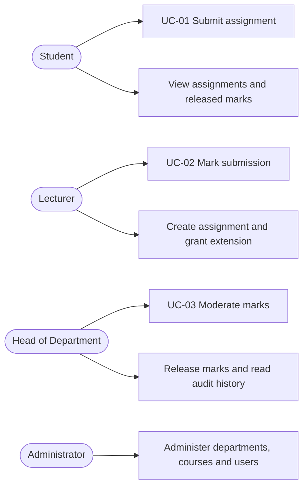
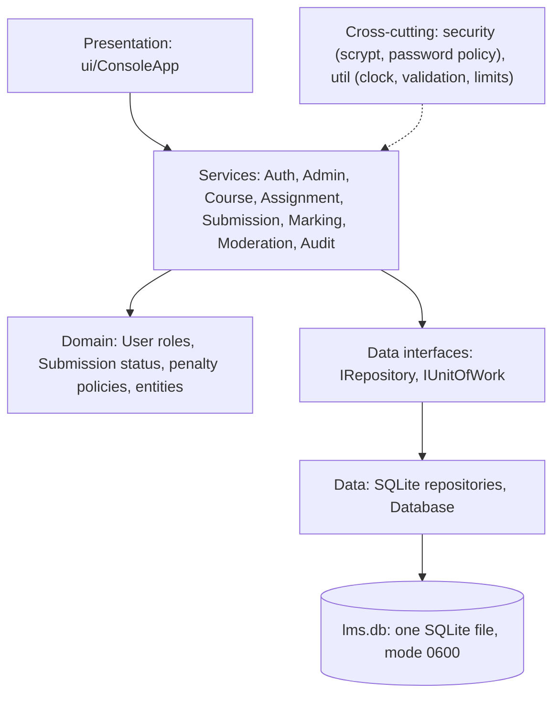
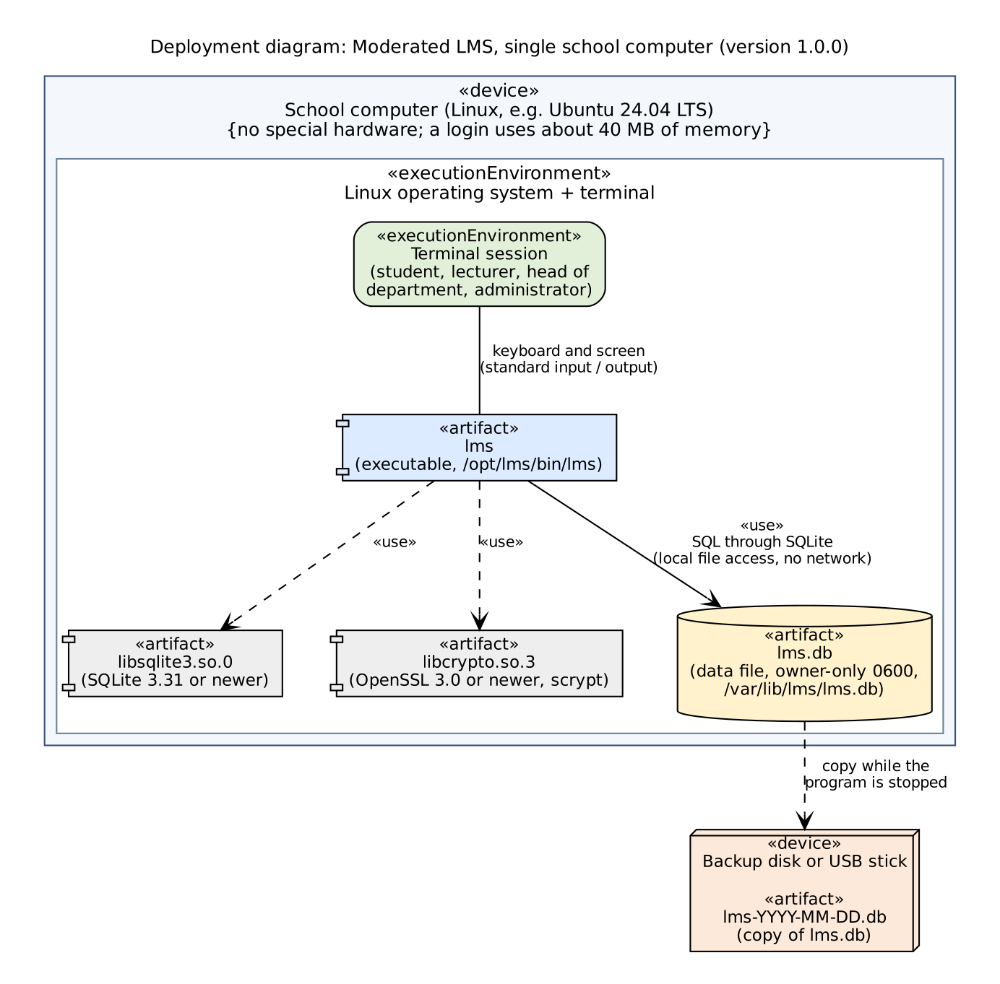
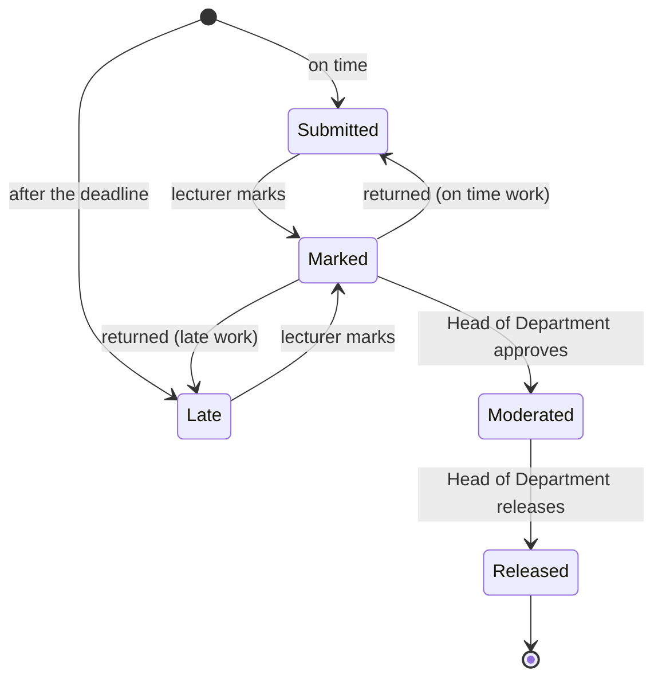

# Moderated Learning Management System: Project Report

| | |
|---|---|
| Course | CS4433 Software Engineering, National University of Lesotho |
| Author | [student name], [student number] |
| Project | Moderated Learning Management System (individual final project) |
| Version reported | 1.1.0 (tag `v1.1.0`) |
| Repository | <https://github.com/katleho419/lms-cs4433> |
| Date | 2026-11-04 |
| Process | Waterfall with the V-model; eight phases, then a maintenance release |

## Abstract

This report describes the whole project, from the problem to the maintenance release. The Moderated Learning Management
System is a C++17 console program with a SQLite database. It lets students submit work, lecturers mark it, and a Head of
Department check every mark before any student can see it. Late penalties are applied by the program, and every change to a
mark is written to a log that nobody can edit.

Version 1.1.0 has 221 automated tests, all passing, and 98.6% line coverage of the business-logic layer. Static analysis
(clang-tidy and cppcheck) reports no findings. Four software defects were found during the project; all are fixed and each
has a regression test. The system has known limits (no password reset, no encryption of the data file, console only), and
these are listed openly in section 13.

This report summarises and connects the project documents in `docs/`. Each section names the document that holds the
detail.

## Contents

1. [Introduction and problem](#1-introduction-and-problem)
2. [Stakeholders and scope](#2-stakeholders-and-scope)
3. [Requirements](#3-requirements)
4. [Use cases](#4-use-cases)
5. [System architecture](#5-system-architecture)
6. [System design](#6-system-design)
7. [Implementation](#7-implementation)
8. [Verification and validation](#8-verification-and-validation)
9. [Quality assurance](#9-quality-assurance)
10. [Deployment and operation](#10-deployment-and-operation)
11. [Maintenance: change request CR1](#11-maintenance-change-request-cr1)
12. [Professional, legal and ethical issues](#12-professional-legal-and-ethical-issues)
13. [Challenges, gaps and future work](#13-challenges-gaps-and-future-work)
14. [Project timeline and releases](#14-project-timeline-and-releases)
15. [Conclusion](#15-conclusion)
16. [Appendices](#appendices)

---

## 1. Introduction and problem

### 1.1 The problem

Marking is a process where a mistake has a real cost for a student. The problem identified for this project has four parts:

| Problem | What goes wrong |
|---|---|
| No second check | A lecturer's mark can reach a student with nobody required to review it first |
| Late rules applied by hand | Deadlines, extensions and penalties depend on who is marking, so equal cases can get different results |
| Changes leave no trace | When a mark changes, there may be no record of who changed it, when, or why |
| Early release | A student can see a mark that is still under review and may still change |

### 1.2 Goal

A system in which every mark is checked by the Head of Department, the late rule is applied by the program in the same way
for everyone, and every change to a mark is recorded permanently.

### 1.3 Approach

The work followed the V-model: each development phase on the left has a test level on the right that checks its output.
The phases were:

| Phase | Work | Tag |
|---|---|---|
| 1 to 3 | Requirements, analysis and design (use cases, class diagrams, state machine, database design) | |
| 4 | Implementation | `v0.4.0` |
| 5 | Verification and validation (unit, integration, system, acceptance tests) | `v0.5.0` |
| 6 | Configuration management and quality assurance (branching, static analysis, metrics, code review) | `v0.6.0` |
| 7 | Release and deployment (installation guide, user manual, release notes) | `v1.0.0` |
| 8 | Maintenance (change request CR1) | `v1.1.0` |

The documents of phases 1 to 3 (the original requirements specification and design diagrams) are the baseline that later
documents refer to, for example `TEST_STRATEGY.md` and `DESIGN_DELTA.md`. This report describes the requirements and design
as they are implemented and tested in version 1.1.0.

---

## 2. Stakeholders and scope

| Group | Interest |
|---|---|
| Students | Fair marks, privacy, seeing only their own work and released marks |
| Lecturers | Mark their own courses, with the late penalty applied for them |
| Heads of Department | Check, adjust, return and release marks in their department |
| Administrator | Creates departments, courses and accounts; assigns lecturers; enrols students |
| The school | Runs the system and is responsible for the data (the "data controller") |

**In scope:** accounts and roles, courses and enrolment, assignments with deadlines and extensions, versioned submissions,
marking with an automatic late penalty, moderation, release, an audit log, a console interface, and a single-computer
deployment.

**Out of scope:** a web or network interface, file uploads, plagiarism checking, e-mail, other time zones than Lesotho
time, a password-reset flow, and encryption of the data file.

---

## 3. Requirements

### 3.1 Main requirements

| ID | Requirement |
|---|---|
| FR1 | **Submit work.** A student submits an answer for an assignment in a course they are enrolled in. Before the deadline they can submit again. After the deadline the work is accepted once and marked LATE |
| FR2 | **Moderated marking and release.** A lecturer marks the work. A Head of Department approves it (and can adjust or return it). Only approved work is released. Students see nothing before release |
| NFR1 | **Security and privacy.** Salted scrypt password hashes, a permission check and a relationship check on every action, parameterised SQL, and a data file readable only by its owner |
| NFR2 | **Accountability and integrity.** A permanent audit log of every mark change, and all-or-nothing transactions for every multi-step operation |

### 3.2 Other functional requirements

| Role | Functions |
|---|---|
| Administrator | Create departments, courses and users; assign lecturers to courses; enrol students; change own password |
| Lecturer | List own courses; create assignments; grant extensions (one student, or the whole class from version 1.1.0); view submissions; mark with feedback |
| Head of Department | Review marks; adjust a mark with a reason; approve one or all marked; return work to the lecturer; release; read the audit history |
| Student | List assignments and released marks; submit and resubmit work |

### 3.3 Business rules

The rules below are the ones named in `TEST_STRATEGY.md` (section 5). Each is traced to at least one automated test.

| Rule | Statement |
|---|---|
| BR-01 | A student's deadline is the assignment deadline, or their extension if they have one |
| BR-02 | Work up to 3 days late is accepted as LATE; later work is accepted as LATE and scores 0 |
| BR-03 | A student may resubmit only before the deadline and while the work is not yet marked |
| BR-04 | A submission is not empty and is at most 100,000 characters |
| BR-05 | Students see no mark, feedback or marking status until release |
| BR-06, BR-07 | A raw mark is between 0 and the maximum; feedback is required |
| BR-08 | The late penalty is 10% of the maximum mark for each started day, up to 3 days |
| BR-09 | A reason is required to change a mark that is already marked |
| BR-10 | After approval, only the Head of Department may change the mark |
| BR-12 | An adjustment needs a reason and writes an audit entry |
| BR-13, BR-14 | A Head of Department acts only in their own department and can see all marks there |
| BR-15 | Only moderated work is released |
| BR-16 | The audit log is append-only, in the application and in the database |

A **late day** is every started 24 hours: 1 hour late is 1 late day; 2.5 days late is 3 late days.

| Maximum 100, raw mark 80 | Final mark |
|---|---:|
| On time | 80 |
| 1 day late | 70 |
| 2 days late | 60 |
| 3 days late | 50 |
| More than 3 days late | 0 |

### 3.4 Non-functional requirements

| Area | Requirement | How it is met |
|---|---|---|
| Security | Passwords never stored in plain text | scrypt (N=32768, r=8, p=1) with a 16-byte salt per user, constant-time comparison |
| Security | Least privilege | Four roles with a permission list; every service checks permission and relationship |
| Integrity | No half-finished operations | `IUnitOfWork`: marking, moderation, release, submission and class extension run in one transaction |
| Integrity | Rules also hold if the program is bypassed | SQL triggers and constraints in the schema |
| Accountability | Every mark change recorded | `audit_entry` table, append-only |
| Privacy | Collect only what is needed | No contact details, health data or tracking |
| Maintainability | Small, layered, testable code | Five layers; highest cyclomatic complexity 14 |
| Testability | Time-dependent rules testable | Injectable clock (`IClock`) |
| Portability | Standard C++17 and common libraries | CMake, SQLite3, OpenSSL 3 |
| Usability | Clear errors, nothing changed on error | Messages start with `!`; invalid input is refused without side effects |

---

## 4. Use cases

The three main use cases are specified in full, with every flow, in `TEST_PLAN_SYSTEM_ACCEPTANCE.md`. The overview:

### 4.1 UC-01 Submit assignment (FR1)

| | |
|---|---|
| Actor | Student |
| Goal | Hand in an answer for an assignment in an enrolled course |
| Main flow | 1. Student chooses Submit work and enters the assignment id. 2. The system checks enrolment. 3. Student types the answer. 4. The system works out the student's deadline, including any extension. 5. The system saves the work as the next version with status SUBMITTED |
| A1 | Before the deadline, the student submits again: the newest version replaces the older ones |
| A2 | After the deadline: the work is accepted once, marked LATE, with the number of late days |
| A3 | An extension makes the work on time for that student |
| Exceptions | E1 empty or over-long answer; E2 not enrolled; E3 unknown assignment; E4 resubmitting after the deadline; E5 resubmitting after marking. Nothing is saved in any exception |

### 4.2 UC-02 Mark submission (FR2, first half)

| | |
|---|---|
| Actor | Lecturer |
| Goal | Give a mark and feedback for a student's work |
| Main flow | The lecturer enters the submission id, a raw mark and feedback. The system applies the late penalty, stores the raw and final mark, sets the status to MARKED and writes an audit entry |
| A1 | Re-marking before approval: a reason is required and is audited |
| A2, A3 | Late work: the final mark is lower than the raw mark; more than 3 days late gives 0 |
| Exceptions | E1 mark above the maximum; E2 missing feedback; E3 lecturer of another course; E4 work already approved (only the Head of Department may change it); E5 unknown submission |

### 4.3 UC-03 Moderate marks (FR2, second half)

| | |
|---|---|
| Actor | Head of Department |
| Goal | Check marks before students see them |
| Main flow | The Head of Department reviews marks for an assignment, approves them (status MODERATED) and releases them (status RELEASED). Only then can students see them |
| A1 | Adjust a mark with a reason; the change is audited |
| A2 | Return work to the lecturer with a comment; it goes back to SUBMITTED or LATE |
| A3, A4 | Approve all marked work shown; read the audit history |
| Exceptions | E4 concurrent change: if the lecturer re-marks after the review screen, that submission is skipped on approval and reported, never approved unseen. Also: wrong department, work not marked, nothing to release |

---

## 5. System architecture

### 5.1 Layers

| Layer | Folder | Responsibility |
|---|---|---|
| Presentation | `src/ui`, `src/app` | Menus and prompts for four roles; the composition root `main.cpp` connects the parts |
| Services | `src/service` | Business rules, permission checks, transactions |
| Domain | `src/domain` | Entities, polymorphic `User`, `Submission` state machine, penalty policies, `UserFactory` |
| Data | `src/data` | Repository interfaces, SQLite implementations, `Database` (connection, schema, transactions) |
| Security and utility | `src/security`, `src/util` | scrypt hashing, password policy, clock, date and time, validation, limits |

Dependency rules (checked in the code review, item E1): the console includes only services and utilities; the domain
includes only the domain, security and utilities; no SQLite type appears outside `data` and `app`. The data layer includes
the `IUnitOfWork` interface on purpose (dependency inversion).

### 5.2 Deployment

The system is one program (`lms`) and one data file (`lms.db`) on one computer. There is no server and no network connection.

| Item | Location | Readable by |
|---|---|---|
| Program | `/opt/lms/bin/lms` | everyone |
| Data file | `/var/lib/lms/lms.db` | the `lms` account only |
| Backups | USB stick or other disk | the technician |

---

## 6. System design

### 6.1 Classes

The original class diagram is the Phase 3 baseline. `DESIGN_DELTA.md` lists every difference between that design and the
implementation. The main classes:

`User` is abstract. Each subclass answers `can(Permission)` for itself, so the services never need an if-else on the role
(polymorphism). `Role` and `Permission` are enumerations. The permissions are: ManageAccounts, ManageDepartments,
ManageCourses, AssignLecturers, EnrolStudents, CreateAssignment, GrantExtension, MarkSubmission, ModerateMarks,
ReleaseMarks, ViewAuditHistory, SubmitWork and ViewOwnMarks.

### 6.2 The submission state machine

A step cannot be skipped, and released work can never change. These rules are enforced twice: in `Submission::transitionTo`
(the only place that changes the status) and in the database, where triggers reject updates to released work.

### 6.3 Design patterns

| Pattern | Where | Why |
|---|---|---|
| Strategy | `IPenaltyPolicy`: `DailyPercentPenalty`, `NoPenalty` | A school can change the late rule without touching the marking code |
| Repository | `IRepository<T>` with SQLite implementations | Services never see SQL, so they are tested with fakes and stubs |
| Unit of Work | `IUnitOfWork`, implemented by `Database::runInTransaction` | A mark and its audit entry commit together or not at all |
| Factory | `UserFactory` (`createUser`, `restore`) | One place builds the right subclass; hashing only happens for new accounts |
| Injectable clock | `IClock`: `SystemClock`, `FixedClock` | Late rules can be tested to the second without waiting |

### 6.4 Database design

One SQLite file, schema in `db/lms_schema.sql`, embedded in the program. The schema version is stored in
`PRAGMA user_version` (currently 1); a different version stops the program instead of damaging data.

| Table | Purpose |
|---|---|
| `department` | Departments |
| `app_user`, `student`, `staff` | All accounts; student number; lecturers and Heads of Department with their department |
| `course`, `course_lecturer`, `enrolment` | Courses, who teaches them, who is enrolled |
| `assignment`, `extension` | Assignments with deadline and maximum mark; individual extended deadlines |
| `submission` | Versioned work, status, late days, raw mark, final mark, feedback |
| `audit_entry` | Append-only log: who changed a mark, when, from what to what, and why |

The database enforces rules by itself: foreign keys, CHECK constraints on role, status and marks, a unique key on
(assignment, student, version), and triggers that reject marks above the maximum, stop released marks changing, require
extensions to be after the deadline, and block UPDATE and DELETE on `audit_entry`. Dates are stored as ISO 8601 UTC text and
shown in Lesotho time (UTC+2).

### 6.5 Security design

| Measure | Detail |
|---|---|
| Password storage | scrypt from OpenSSL 3; stored as `scrypt$N$r$p$hexkey` so the cost can be raised later; stored parameters are range-checked |
| Password policy | 8 to 128 characters, at least one letter and one digit, not equal to the username |
| Login | One message for an unknown user and a wrong password; a dummy hash is computed for an unknown user so timing does not reveal it; five failures exit the program |
| Access control | Permission check, then a relationship check (lecturer teaches the course, Head of Department owns the department, student is enrolled) |
| SQL | Prepared statements with bound parameters only |
| Data file | Created readable by its owner only (mode 0600) |
| Hidden marks | `Submission::redactedForStudent()` removes marks and feedback until release |

### 6.6 Differences between design and implementation

Ten differences are recorded in `DESIGN_DELTA.md`. The most important: a unit of work and a clock were added; an
`AdminService` and department and course repositories were added; a return path from MARKED to SUBMITTED/LATE was added; and
two protections were added after defects DEF-01 (hidden marks) and DEF-02 (stale approval).

---

## 7. Implementation

### 7.1 Technology

| Item | Choice |
|---|---|
| Language | C++17, no extensions, warnings as errors (`-Wall -Wextra -Wpedantic -Wshadow -Wconversion`) |
| Build | CMake 3.16 or newer with Ninja |
| Database | SQLite 3 through its C API, wrapped in RAII classes |
| Hashing | OpenSSL 3 (scrypt) |
| Tests | GoogleTest 1.14 |
| Analysis | clang-tidy 18, cppcheck, clang-format; `tools/metrics.py`, `tools/coverage.py` |
| CI | GitHub Actions: `build-test` and `static-analysis` jobs |
| Environment | Ubuntu 24.04, g++ 13, VS Code |

### 7.2 Size

| | Code lines |
|---|---:|
| Production code in `src/` (53 files, measured at v1.0.0) | 3,661 |
| Test code (7 files, measured at v1.0.0) | 1,997 |
| Added by CR1 | about 80 production, about 190 test |

The service and domain layers, which hold the business rules, are about 40% of the production code; the console is 21%.

### 7.3 Coding standard

C++17; 4-space indentation; types in CamelCase, members with a trailing underscore, functions in camelCase; RAII for every
resource; all exceptions derive from `lms::LmsError` (`ValidationError`, `AuthorizationError`, `AuthenticationError`,
`BusinessRuleError`, `NotFoundError`, `DatabaseError`). All text length limits are in one header, `util/Limits.hpp`.

### 7.4 Configuration management

The project uses **GitHub Flow with release tags** (`BRANCHING_STRATEGY.md`).

| Rule | Detail |
|---|---|
| One long-lived branch | `main` always builds and passes all tests |
| Topic branches | `feature/`, `fix/`, `test/`, `docs/`, `chore/` prefixes; merged only by pull request |
| CI gate | The `build-test` job (warnings as errors, all tests, coverage threshold) and the `static-analysis` job (clang-tidy, cppcheck, metrics) must pass; four checks per pull request |
| Merge style | Merge commit, so the branch stays visible in history |
| Releases | Annotated semantic-version tags |
| Honest note | Phases 1 to 5 were committed straight to `main`, before the strategy was adopted. Pull requests with CI start at #1 (Phase 5). History was not rewritten |

---

## 8. Verification and validation

### 8.1 Strategy

The test strategy (`TEST_STRATEGY.md`) follows the V-model. Each level checks the output of a development phase:

| Level | Checks | Tests |
|---|---|---:|
| Unit | Single classes with no database: dates, validation, password hashing, users and permissions, penalty policies, the submission state machine | 59 |
| Integration | Services with real SQLite repositories on an in-memory database; transactions and rollback; triggers; stub repositories that throw | 100 |
| System | Complete use cases through the real console with scripted input, checking both the screen and the database | 41 |
| Acceptance | One story per role, taken from the Phase 1 requirements | 5 |
| Version 1.0.0 total | | 207 |
| CR1 (version 1.1.0) | 10 service tests, 4 system tests | 14 |
| **Version 1.1.0 total** | | **221** |

Counts for the first four rows are from the run at version 0.5.0 (205 tests); two regression tests were added in Phase 6.

### 8.2 Test design

Tests were written from the use cases and the business rules, not from the code. Techniques were equivalence partitioning
and boundary value analysis. Examples: deadline minus 1 second, the deadline, and deadline plus 1 second; marks of -1, 0, 1,
maximum minus 1, maximum and maximum plus 1; reasons of 0, 1, 600 and 601 characters; exactly 3 days late. Role and
relationship checks were tested against every restricted function: a lecturer of another course, a Head of Department of
another department, and an unenrolled student.

All tests run with a fixed clock (2026-11-01 08:00 UTC; deadline exactly 7 days later) and an in-memory database, so none
depends on the date or on files.

### 8.3 Results over time

| Run | Tests | Passed | Failed |
|---|---:|---:|---:|
| First full run (Phase 5) | 151 | 149 | 2 |
| After fixing DEF-01, DEF-02 and a test error | 159 | 159 | 0 |
| With system and acceptance tests | 204 | 204 | 0 |
| After the boundary test SYS22b (TG-01) | 205 | 205 | 0 |
| After the Phase 6 code review fixes (version 1.0.0) | 207 | 207 | 0 |
| Version 1.1.0 (CR1) | 221 | 221 | 0 |

### 8.4 Coverage

Line coverage with gcov, using `tools/coverage.py`. The target in the brief was at least 70% of the business-logic layer.

| Version | Tests | Business-logic coverage |
|---|---:|---:|
| 0.5.0 | 205 | 98.4% |
| 1.0.0 | 207 | 98.2% |
| 1.1.0 | 221 | 98.6% |

The uncovered lines are code that normal use cannot reach: the `throw` that follows an exhaustive `switch`, and error paths
for a failed random-number or scrypt call inside OpenSSL. The console and `main.cpp` are exercised by the system tests.

### 8.5 Defects

Four software defects were found over the project (`DEFECT_LOG.md`). All are fixed with a regression test; none is open.

| ID | Found by | Defect | Severity |
|---|---|---|---|
| DEF-01 | Integration test `UC03_BR05` | The student's assignment list returned the raw mark, final mark and feedback of marked work before release | High |
| DEF-02 | Test design for UC-03 E4 | Concurrent change not detected: the Head of Department reviewed 70, the lecturer re-marked to 40, and approving moderated 40 without a warning | High |
| DEF-03 | Code review | The database file was created readable by every user of the computer (`-rw-r--r--`) | Medium |
| DEF-04 | Code review | The reason for changing a mark was length-checked after text was added to it, against a different limit | Low |

Two other entries are not software defects: TE-01 (an error in a test script) and TG-01 (a gap in the tests: no test marked
work exactly 3 days late). TG-01 was found by putting a fault in on purpose; all 45 system tests still passed, so test
SYS22b was added.

DEF-01 and DEF-02 were found by the integration tests and were not found by either static analyser. DEF-03 and DEF-04
were found by the code review. The system and acceptance tests found no new software defect, and the log says so rather than
inventing one.

### 8.6 Tests that can fail

For each change from Phase 5 onward, the rule under test was removed on purpose to check that a test noticed. Examples: the
late window changed to "3 days or more" (found a gap, TG-01); file permissions and the reason limit (the new tests failed
without the fix); and for CR1 four faults (class extension overwriting a longer extension, no transaction, student list
showing the original deadline, last student skipped), which made 3, 1, 2 and 10 tests fail. Each fault was then removed.

### 8.7 Validation

Acceptance scenarios, one per role plus a restart test, check that a person can reach their goal with the menus alone: a
student submits and sees a mark only after release; a lecturer sets up and marks work; a Head of Department moderates,
adjusts, releases and checks the audit trail; the administrator sets up a term from an empty system; and marks survive
closing and reopening the program. The built executable was also run with piped input against a database file.

---

## 9. Quality assurance

### 9.1 Static analysis (`STATIC_ANALYSIS_REPORT.md`)

| Run | clang-tidy | cppcheck |
|---|---:|---:|
| Before | 221 findings | 3 findings |
| After | 0 | 0 |

The 221 clang-tidy findings were mostly style (153 missing braces). Sixteen were worth fixing for correctness or safety,
including eight unchecked reads of a `std::optional`. The most valuable change was splitting the huge menu functions
(`adminMenu`, `hodMenu`) into one dispatcher per role and one small method per action. No `NOLINT` suppressions are used.

Both analysers run in CI on every push and pull request, and any finding fails the build.

### 9.2 Metrics (`METRICS_REPORT.md`)

| | At v0.5.0 | At v1.0.0 |
|---|---:|---:|
| Functions measured | 286 | 315 |
| Average cyclomatic complexity | 2.64 | 2.47 |
| Maximum cyclomatic complexity | 35 | 14 |
| Functions above the hard limit of 15 | 4 | 0 |
| Longest function (code lines) | 105 | 62 |

Nine in ten functions have a complexity of 5 or less. Seven functions are above the warning limit of 10; each was reviewed
and the decision is recorded. Version 1.1.0 left the maximum at 14. The metrics script was checked by hand on three
functions; it was not compared with `lizard`, which could not be installed.

### 9.3 Code review (`CODE_REVIEW_RECORD.md`)

A self review against a 35-item checklist (`CODE_REVIEW_CHECKLIST.md`). Twenty-nine items passed, and five findings were
fixed and retested (R-01 to R-05); none is open. Two were software defects (DEF-03 and DEF-04); the others were scattered
limit numbers (now in `util/Limits.hpp`), a missing warning against using the demo accounts on a real installation, and a
header without a description. Ten observations were recorded where no change was needed. The review was done by the author,
which is a limitation: a second reviewer would find different things.

---

## 10. Deployment and operation

The installation guide (`INSTALLATION_GUIDE.md`) is written for a school technician who does not know C++. It was written
and its commands checked on Ubuntu 24.04. In outline:

1. Install the tools: `build-essential`, `cmake`, `libsqlite3-dev`, `libssl-dev`, `git`.
2. Get the source and check out the version tag.
3. Build in Release mode; install to `/opt/lms`.
4. Create a `lms` account and a private data folder (`/var/lib/lms`, mode 700).
5. Start the program once to create the first administrator.
6. Run five checks: the program is installed; the data file is mode `-rw-------`; the release build has no test clock; the
   administrator can log in; a wrong password is refused.

The guide also covers daily start-up, backup and restore, upgrading (back up, check out the new tag, rebuild; the data file is
untouched), uninstalling, troubleshooting, a security checklist, and a handover sheet. The user manual (`USER_MANUAL.md`)
has one section for each role and a table of messages.

---

## 11. Maintenance: change request CR1

After release 1.0.0, a change request added two things (`CHANGE_REQUEST_CR1.md`):

1. **Whole-class extension.** A lecturer can give every enrolled student the same new deadline in one action.
2. **Visible deadline.** The student's assignment list shows the deadline that applies to them, for example
   `due 2026-11-13 12:00 (extended from 2026-11-10 23:47)`.

| Aspect | Decision |
|---|---|
| Type | Perfective maintenance; also removes known limitation 1 of version 1.0.0 |
| Options | A: a class deadline column (rejected: loses who had an extension, needs a database change). B: one extension row per student, written together (chosen: no database change). C: loop in the console (rejected: not all-or-nothing) |
| Impact | Two services changed (`AssignmentService`, `SubmissionService`), the console, `main.cpp`; no database, domain or data-layer change |
| Size | About 80 lines of production code and 190 lines of tests |
| Rules | Only the lecturer of the course; the new deadline must be later than the assignment's; an extension is never shortened; all or nothing; an empty course is refused |
| Verification | 14 new tests; all 207 earlier tests pass unchanged; coverage 98.6%; clang-tidy 0 findings; four deliberate faults each made tests fail |
| Release | `v1.1.0`; a 1.0.0 data file opens in 1.1.0 and the other way round |

---

## 12. Professional, legal and ethical issues

Full analysis: `PROFESSIONAL_ISSUES.md`. It is an engineering reading of the law, not legal advice.

| Topic | Summary |
|---|---|
| Data protection | The Data Protection Act of Lesotho (Act No. 5 of 2012) applies to the school as data controller. The system collects only what it needs and keeps no contact, health or location data. The document maps each requirement to what the system does and what the school must do (privacy notice, retention rule, breach procedure, notification to the Commission) |
| Gaps against the Act | No retention or deletion feature, no data export, and the data file is not encrypted. These are stated openly |
| Children's data | If a school installs it for learners under 18, the rules on children's data apply and parental consent must be arranged by the school |
| Licences | SQLite is public domain; OpenSSL 3 is Apache 2.0; GoogleTest is BSD 3-Clause (tests only). The repository has no `LICENSE` file yet, so nobody else may legally reuse the code until the author chooses one |
| Ethics | Checked against the ACM Code of Ethics: avoid harm (a wrong mark affects a student), honesty (limits are published), fairness (one late rule for everyone), privacy, confidentiality, accountability (the audit log) |
| Specific questions | Fairness of an automatic penalty that depends on the clock; who watches the watchers (the log cannot be edited, even with SQL); what the administrator can see; retention versus deletion; access and inclusion |
| AI assistance | The project was developed with an AI assistant that helped write and review code, tests and documents. The author directed the work and is responsible for it. The course rules on declaring this apply |

---

## 13. Challenges, gaps and future work

### 13.1 Challenges

| Challenge | What happened and what was done |
|---|---|
| Concurrent change | A mark could change while the Head of Department was reviewing it (DEF-02). Approval now compares the reviewed mark with the current one and skips changed work |
| Hidden data | Marks must not leak through any list or screen (DEF-01). The rule is enforced in the service layer with `redactedForStudent`, not only on screen |
| Time | Lateness depends on the clock. The clock is injectable and tests use a fixed time. Late days are counted in started 24-hour blocks, tested at every boundary |
| Complexity | The first menu code had functions with complexity up to 35 and cognitive complexity up to 79. They were split, and the maximum is now 14 |
| Tools | GoogleTest was lost from the development machine and could not be downloaded again, so the CR1 tests were first run with a small stand-in runner. This was disclosed in the documents; the CI run with the real framework is the authoritative result |
| Early process | Phases 1 to 5 were committed straight to `main`, before branching and CI were in place. This was corrected from Phase 6 and recorded rather than hidden |
| Law and ethics | Data protection duties, children's data, and retention versus an audit log that is permanent on purpose |

### 13.2 Known limitations of version 1.1.0

| # | Limitation | Effect |
|---|---|---|
| 1 | No password reset | The administrator creates a new account for a user who forgot the password |
| 2 | The data file is not encrypted | Protect the computer and backups; the file is owner-only on Linux and macOS |
| 3 | Times shown and typed in Lesotho time only | Not suitable for other time zones without a change |
| 4 | One computer, one data file, console interface | Users sit at the school computer or log in to it by SSH |
| 5 | Five wrong passwords close the program, but no lock lasts across restarts | Not protection against a determined guesser |
| 6 | Tested on Ubuntu 24.04 only | Windows and macOS build instructions are unverified |
| 7 | cppcheck could not be installed in the development environment | It runs in CI on an Ubuntu runner |
| 8 | A lecturer cannot list who has an extension; extensions are not audited; students enrolled after a class extension must be extended separately | See `CHANGE_REQUEST_CR1.md`, section 8 |
| 9 | No data export and no retention tool | The school needs a manual procedure (Data Protection Act sections 19, 26 and 27) |
| 10 | The code review was a self review | A second reviewer was not available |

### 13.3 Future work

| Gap | Idea |
|---|---|
| No export of a person's data | A report for one student or staff member |
| No retention tool | An archive-and-remove procedure for finished terms that respects the audit log |
| Data file not encrypted | SQLCipher or disk encryption |
| No password reset | An administrator reset that forces a change at the next login |
| Names cannot be corrected | An "edit user" function with an audit entry |
| Extensions not visible to the lecturer | A report of who has an extension |
| Console only | A web interface, a Sesotho version, and screen-reader testing |

---

## 14. Project timeline and releases

| Tag | Meaning | Tests | Business-logic coverage |
|---|---|---:|---:|
| `v0.4.0` | Implementation complete (Phase 4) | | |
| `v0.5.0` | Verification and validation complete (Phase 5) | 205 | 98.4% |
| `v0.6.0` | Configuration management and quality assurance (Phase 6) | 207 | 98.2% |
| `v1.0.0` | First release: installation guide, user manual, release notes (Phase 7) | 207 | 98.2% |
| `v1.1.0` | Maintenance release, change request CR1 (Phase 8) | 221 | 98.6% |

After `v1.1.0`, the professional, legal and ethical document, the deployment diagram export, this report and the project
video were added to the repository and the release.

---

## 15. Conclusion

The project produced a working, tested and documented system that does what it was built to do: no mark reaches a student
before a Head of Department has checked it, the late rule is applied the same way every time, and every change to a mark is
recorded permanently. The project followed the V-model, and each phase left a document that the next phase used.

Three lessons stand out. First, tests written from the use cases found the two serious defects that static analysis could
not see, and the code review found two more that the tests had no reason to look for, so each technique is needed.
Second, testing the tests (putting faults in on purpose) found a real gap. Third, writing the limits down, in the release
notes, the security notes and this report, makes the system honest and lets a school decide whether it is acceptable.

---

## Appendices

### A. Document index

| Document | Purpose |
|---|---|
| `README.md` | Build, run, layout, coding standard |
| `docs/BUILD.md`, `DATABASE.md`, `SECURITY.md` | Developer notes: build, data, security |
| `docs/DESIGN_DELTA.md` | Differences between the Phase 3 design and the implementation |
| `docs/TEST_STRATEGY.md`, `TEST_PLAN_SYSTEM_ACCEPTANCE.md`, `TEST_RESULTS.md`, `COVERAGE_REPORT.md`, `DEFECT_LOG.md` | Verification and validation |
| `docs/BRANCHING_STRATEGY.md`, `STATIC_ANALYSIS_REPORT.md`, `METRICS_REPORT.md`, `CODE_REVIEW_CHECKLIST.md`, `CODE_REVIEW_RECORD.md` | Configuration management and quality assurance |
| `docs/INSTALLATION_GUIDE.md`, `USER_MANUAL.md`, `RELEASE_NOTES.md`, `diagrams/` | Deployment and use |
| `docs/CHANGE_REQUEST_CR1.md` | Maintenance |
| `docs/PROFESSIONAL_ISSUES.md` | Legal, professional and ethical issues |
| `docs/PROJECT_REPORT.md` | This report |

### B. How to build, run and test

    sudo apt install -y build-essential cmake libsqlite3-dev libssl-dev
    cmake -S . -B build -DCMAKE_BUILD_TYPE=Release
    cmake --build build
    ./build/lms --db /tmp/demo.db --seed-demo     # demonstration only; never on a real installation

    # tests
    cmake -S . -B build -G Ninja -DLMS_BUILD_TESTS=ON -DLMS_ENABLE_COVERAGE=ON
    cmake --build build
    ctest --test-dir build --output-on-failure
    python3 tools/coverage.py build

### C. Demonstration order

1. Log in as `student1`, list assignments and submit work.
2. Log in as `lecturer`, view submissions and mark one.
3. Log in as `hod`, review, approve and release.
4. Log in as `student1` again and see the released mark.

### D. Evidence and honesty notes

- The final GoogleTest run for version 1.1.0 is the `build-test` check on the pull request for CR1. Before that, the 221
  tests were run with a stand-in runner, as stated in `TEST_RESULTS.md`.
- Coverage figures are line coverage measured with gcov; the console and `main.cpp` are not part of the business-logic figure.
- Metrics were produced by `tools/metrics.py` and were not compared with an independent tool.
- The Phase 1 to 3 documents are the baseline for requirements and design; where the implementation differs, `DESIGN_DELTA.md`
  records the difference and the reason.
- The video of the project is attached to the `v1.1.0` release on GitHub.
